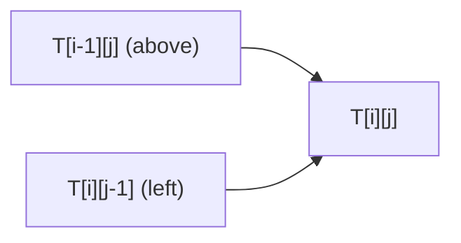

# 2026 CS2 Q39: Filling a DP table in two orders

## Question

A table $T$ has entries $T[i][j]$ for $0 \le i, j \le n$, defined by

$$T[0][k] = T[k][0] = 1 \quad (k = 0, 1, \dots, n)$$

$$T[i][j] = 2\,T[i-1][j] + 3\,T[i][j-1] \quad (1 \le i, j \le n)$$

Assume every $T[i][j]$ is initialised to 1 for both algorithms.

**Algorithm B1:**

```text
for i = 1..n
  for j = 1..n
    T[i][j] = 2*T[i-1][j] + 3*T[i][j-1]
```

**Algorithm B2:**

```text
for s = 2..2n
  for i = 1..n
    for j = 1..n
      if (i + j == s)
        T[i][j] = 2*T[i-1][j] + 3*T[i][j-1]
```

An algorithm is *correct* if and only if it produces the right $T[i][j]$ for all $0 \le i, j \le n$. Which statement is true?

- (A) Both B1 and B2 are correct
- (B) B1 is correct, B2 is incorrect
- (C) B2 is correct, B1 is incorrect
- (D) Both B1 and B2 are incorrect

<details class="success" markdown="1">
<summary>Answer</summary>

**A**

</details>

<details class="info" markdown="1">
<summary>Solution</summary>

**Refresher.** A DP table can be filled in any order, as long as each cell is computed **after** the cells it depends on.

Each $T[i][j]$ depends on two cells:

- $T[i-1][j]$, the cell above,
- $T[i][j-1]$, the cell to the left.



**B1 (row by row).**

- $T[i-1][j]$ is in the previous row, which is already finished.
- $T[i][j-1]$ is earlier in the same row, so already computed.
- The boundary cells ($i=0$ or $j=0$) are 1 from initialisation, as required.

B1 is correct.

**B2 (diagonal by diagonal).** A cell $(i, j)$ is computed when $s = i + j$.

- Both $(i-1, j)$ and $(i, j-1)$ have sum $s - 1$.
- Sum $s-1$ was handled in the previous pass of the outer loop (or is a boundary cell, already 1).

So every dependency is ready, and B2 is correct too. It is just slower: $\Theta(n^3)$ because of the useless inner double loop, against $\Theta(n^2)$ for B1.

Order for $n = 3$ (the number shows which pass $s$ computes the cell):

| | $j=1$ | $j=2$ | $j=3$ |
|---|---|---|---|
| $i=1$ | 2 | 3 | 4 |
| $i=2$ | 3 | 4 | 5 |
| $i=3$ | 4 | 5 | 6 |

**Why the others fail:**

- **(B)** wrongly thinks diagonal order breaks the dependencies. It does not.
- **(C)** wrongly thinks row order breaks them. It does not.
- **(D)** would need both orders to break a dependency.

**Verified.** I ran both algorithms for $n = 1$ to $8$ and compared them with the recursive definition. Both matched in every case.

**Key idea:** any order that respects the dependency direction (up and left here) is a valid DP fill order. Correctness is about order, not about being the cheapest.

</details>
