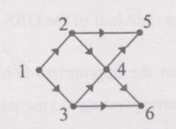

# 2007 CS Q5: Which sequence is not a topological ordering

## Question

Consider the DAG with $V = \lbrace 1,2,3,4,5,6 \rbrace$, shown below.

Which of the following is **NOT** a topological ordering?

- (A) 1 2 3 4 5 6
- (B) 1 3 2 4 5 6
- (C) 1 3 2 4 6 5
- (D) 3 2 4 1 6 5

Answer

**D**

Solution

Edges read from the figure: $1\to2,\ 1\to3,\ 2\to4,\ 2\to5,\ 3\to4,\ 3\to6,\ 4\to5,\ 4\to6$.

A topological ordering must list the tail of every edge before its head.

- (A) 1 2 3 4 5 6: all edges go forward. Valid.
- (B) 1 3 2 4 5 6: valid.
- (C) 1 3 2 4 6 5: 5 and 6 are unrelated, so either order is fine. Valid.
- (D) 3 2 4 1 6 5: vertex 3 comes before 1, but $1 \to 3$ requires 1 first. **Invalid.**

So (D) is not a topological ordering.

**Code check:** checked all 720 permutations against the 8 edges: exactly 4 are valid orderings; A, B and C are among them, D is not.

**Classification note:** borderline. Topological ordering is a property of a DAG (discrete mathematics) but it is the output of an algorithm, so by the repo boundary rule it goes to `algorithms/graph-algorithms`.

**Status note:** `unverified`. GATE 2007 had no official answer key, so there is nothing to compare against. This is my own answer.

**Key idea:** a topological order puts every edge's tail before its head; only vertex 1 has no incoming edge, so it must come first.

