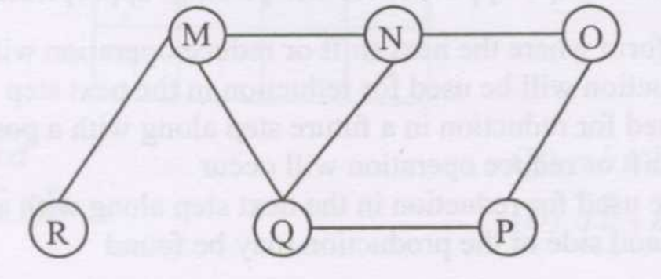

# 2008 CS Q19: Which sequence can be a breadth first search order

## Question

The Breadth First Search algorithm has been implemented using the queue data structure. One possible order of visiting the nodes of the following graph is

- (A) MNOPQR
- (B) NQMPOR
- (C) QMNPRO
- (D) QMNPOR

Answer

**C**

Solution

Adjacency lists: $M$: N, Q, R; $N$: M, O, Q; $O$: N, P; $P$: O, Q; $Q$: M, N, P; $R$: M.

BFS visits the start vertex, then **all** its neighbours (in any order), then their unvisited neighbours, level by level.

- (A) M N O P Q R: starts at M, so N, Q, R must come right after it. But O (distance 2) appears before Q and R. Not BFS.
- (B) N Q M P O R: starts at N, so its neighbours M, O, Q come first. P (distance 2) appears before O. Not BFS.
- (C) Q M N P R O: start Q, level 1 is M, N, P (all neighbours of Q), then R (from M) and O (from N). **Valid.**
- (D) Q M N P O R: Q, M, N, P are right, but M is dequeued before N, so M's new neighbour R is enqueued before N's new neighbour O. R must therefore come before O. Not BFS.

**Code check:** a checker that simulates BFS and fixes ties by the given order accepts only (C): A false, B false, C true, D false.

**Key idea:** in a BFS order every vertex at distance $d$ comes before every vertex at distance $d+1$, and the children appear in the same order as their parents.

