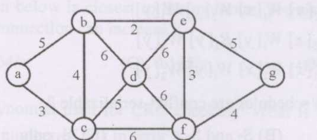

# 2009 CS Q38: Which edge sequence Kruskal's algorithm cannot produce

## Question

Consider the following graph:

Which one of the following is **NOT** the sequence of edges added to the minimum spanning tree using Kruskal's algorithm?

- (A) (b, e) (e, f) (a, c) (b, c) (f, g) (c, d)
- (B) (b, e) (e, f) (a, c) (f, g) (b, c) (c, d)
- (C) (b, e) (a, c) (e, f) (b, c) (f, g) (c, d)
- (D) (b, e) (e, f) (b, c) (a, c) (f, g) (c, d)

Answer

**D**

Solution

Kruskal's algorithm takes edges in **non-decreasing weight order** (ties in any order) and keeps an edge only if it joins two different components.

Sorted by weight: $be\,(2)$; $ac\,(3),\ ef\,(3)$; $bc\,(4),\ fg\,(4)$; $ab\,(5),\ cd\,(5),\ eg\,(5)$; then the weight-$6$ edges.

- Weight 2: add $be$.
- Weight 3: add $ac$ and $ef$ (either order).
- Weight 4: add $bc$ (joins $\lbrace a, c \rbrace$ to $\lbrace b, e, f \rbrace$) and $fg$ (either order).
- Weight 5: $ab$ and $eg$ would close cycles, so they are skipped; $cd$ joins $d$, so it is added.

The tree has weight $21$ and the valid sequences are: $be$, then $\lbrace ac, ef \rbrace$ in either order, then $\lbrace bc, fg \rbrace$ in either order, then $cd$. That is $4$ sequences.

- (A), (B) and (C) fit this pattern.
- (D) adds $bc$ (weight $4$) **before** $ac$ (weight $3$). Kruskal never does that, so (D) is not a possible sequence: (D).

**Code check:** enumerating every tie-breaking order of Kruskal's algorithm on this graph gave exactly $4$ sequences (MST weight $21$). Options (A), (B), (C) are among them; (D) is not.

**Key idea:** a Kruskal sequence must respect weight order; only equal-weight edges can be swapped.

