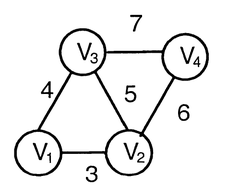

# 2011 CS Q54: Cost of the minimum spanning tree of a banded graph

## Question

**Linked Answer Questions 54 and 55.**

An undirected graph $G(V, E)$ contains $n$ ($n > 2$) nodes named $v_1, v_2, \ldots, v_n$. Two nodes $v_i, v_j$ are connected if and only if $0 < |i - j| \le 2$. Each edge $(v_i, v_j)$ is assigned a weight $i + j$. A sample graph with $n = 4$ is shown below.

What will be the cost of the minimum spanning tree (MST) of such a graph with $n$ nodes?

- (A) $\frac{1}{12}(11 n^2 - 5n)$
- (B) $n^2 - n + 1$
- (C) $6n - 11$
- (D) $2n + 1$

Answer

**B**

Solution

Run Kruskal's algorithm on the edges sorted by weight. The edges are $(i, i+1)$ of weight $2i + 1$ and $(i, i+2)$ of weight $2i + 2$.

- $(1,2)$ weight $3$ and $(1,3)$ weight $4$ are accepted.
- $(2,3)$ weight $5$ closes the cycle $1$-$2$-$3$: rejected.
- For $i \ge 2$, the edge $(i, i+1)$ of weight $2i + 1$ is rejected: both ends are already connected, $i$ through $(i-2, i)$ and $i + 1$ through $(i-1, i+1)$ (weight $2i$, considered earlier), and both chains meet at the edge $(1,2)$.
- The edge $(i, i+2)$ of weight $2i + 2$ is accepted for every $i \ge 1$: it brings in the new vertex $i + 2$.

So the MST consists of $(1,2)$ and $(k-2, k)$ for $k = 3, \ldots, n$, with cost

$$3 + \sum_{k=3}^{n} (2k - 2) = 3 + \left(n^2 - n - 2\right) = n^2 - n + 1.$$

Check for $n = 4$: $3 + 4 + 6 = 13 = 16 - 4 + 1$. So (B).

- (A), (B) and (C) all give $13$ at $n = 4$, so test $n = 5$: the MST costs $3 + 4 + 6 + 8 = 21$, while (A) gives $20.83$ and (C) gives $19$. (D) is already wrong at $n = 4$ ($9$).

**Code check:** Kruskal's algorithm for $n = 3, \ldots, 8$ gave costs $7, 13, 21, 31, 43, 57$, equal to $n^2 - n + 1$ each time. Options (A) and (C) differ from these from $n = 5$ on, and (D) from $n = 4$ on.

**Key idea:** build the MST by Kruskal: only the edges (v_{k-2}, v_k) and (v_1, v_2) survive, giving n^2 - n + 1.

