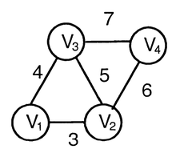

# 2011 CS Q55: Path length between v5 and v6 in the MST

## Question

**Linked Answer Questions 54 and 55.**

An undirected graph $G(V, E)$ contains $n$ ($n > 2$) nodes named $v_1, v_2, \ldots, v_n$. Two nodes $v_i, v_j$ are connected if and only if $0 < |i - j| \le 2$. Each edge $(v_i, v_j)$ is assigned a weight $i + j$. A sample graph with $n = 4$ is shown below.

The length of the path from $v_5$ to $v_6$ in the MST of previous question with $n = 10$ is

- (A) 11
- (B) 25
- (C) 31
- (D) 41

Answer

**C**

Solution

From Q54 the MST for $n = 10$ has the edges $(v_1, v_2)$ and $(v_{k-2}, v_k)$ for $k = 3, \ldots, 10$. It is two chains joined by $(v_1, v_2)$:

- odd chain: $v_1 - v_3 - v_5 - v_7 - v_9$ (weights $4, 8, 12, 16$)
- even chain: $v_2 - v_4 - v_6 - v_8 - v_{10}$ (weights $6, 10, 14, 18$)
- link: $v_1 - v_2$ (weight $3$)

The only path in a tree from $v_5$ to $v_6$ is $v_5 - v_3 - v_1 - v_2 - v_4 - v_6$:

$$8 + 4 + 3 + 6 + 10 = 31$$

So (C).

- (A) $11$ is the weight of the direct edge $(v_5, v_6)$, which is not in the MST.

**Code check:** Kruskal on the $n = 10$ graph gave the MST edges above, and the tree path from $v_5$ to $v_6$ was $[5, 3, 1, 2, 4, 6]$ with length $31$.

**Key idea:** in a tree there is a single path between two vertices; follow it through the two chains of the MST.

