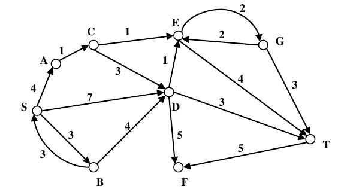

# 2012 CS Q40: Dijkstra's path with ties on a weighted directed graph

## Question

Consider the directed graph shown in the figure below. There are multiple shortest paths between vertices S and T. Which one will be reported by Dijkstra's shortest path algorithm? Assume that, in any iteration, the shortest path to a vertex $v$ is updated only when a strictly shorter path to $v$ is discovered.

- (A) SDT
- (B) SBDT
- (C) SACDT
- (D) SACET

Answer

**D**

Solution

**Edges read from the figure:** S→A 4, S→B 3, S→D 7, B→S 3, B→D 4, A→C 1, C→E 1, C→D 3, D→E 1, D→T 3, D→F 5, E→G 2, G→E 2, E→T 4, G→T 3, T→F 5.

**Dijkstra trace** (a label changes only on a strictly shorter path):

| Settle | Distance | Updates |
|---|---|---|
| S | 0 | A=4, B=3, D=7 |
| B | 3 | D via B = 7, not shorter: D stays 7 (via S) |
| A | 4 | C=5 |
| C | 5 | E=6; D via C = 8, no |
| E | 6 | T=10 (via E); G=8 |
| D | 7 | T via D = 10, not strictly shorter: T stays via E; F=12 |
| G | 8 | T via G = 11, no |
| T | 10 | |

T keeps its first label, found through E. The reported path is **S → A → C → E → T**, of length $4+1+1+4 = 10$: (D).

**The ties.** SDT ($7+3$) and SBDT ($3+4+3$) also cost $10$, but T is never updated by D, because $10$ is not strictly shorter than $10$. SACDT costs $4+1+3+3 = 11$, so it is not a shortest path at all.

**Code check:** a Dijkstra run with strict-improvement updates on this edge list returned SACET with distance $10$. A search for all shortest paths found exactly SACET, SDT and SBDT. The edge list was read from the figure by eye.

**Key idea:** with strict-improvement updates, the first shortest path to reach a vertex is the one reported.

