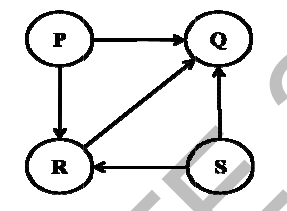

# 2014 CS1 Q13: Topological orderings of a 4-vertex DAG

## Question

Consider the directed graph given below.

Which one of the following is **TRUE**?

- (A) The graph does not have any topological ordering.
- (B) Both PQRS and SRQP are topological orderings.
- (C) Both PSRQ and SPRQ are topological orderings.
- (D) PSRQ is the only topological ordering.

Answer

**C**

Solution

Edges: $P \to Q$, $P \to R$, $R \to Q$, $S \to R$, $S \to Q$.

$P$ and $S$ have no incoming edges. $R$ needs both $P$ and $S$ before it. $Q$ needs $P$, $R$ and $S$ before it. So $Q$ is last, $R$ is third, and $P$, $S$ can come in either order:

$$P\,S\,R\,Q \quad\text{and}\quad S\,P\,R\,Q$$

**Code check:** trying all 24 permutations gives exactly `PSRQ` and `SPRQ`.

- (A) the graph is acyclic, so it has orderings.
- (B) in PQRS, $Q$ comes before $R$ but $R \to Q$. In SRQP, $P$ is last but $P \to Q$.
- (D) SPRQ is also valid.

**Key idea:** list the vertices with no incoming edges; ties give multiple orderings.

