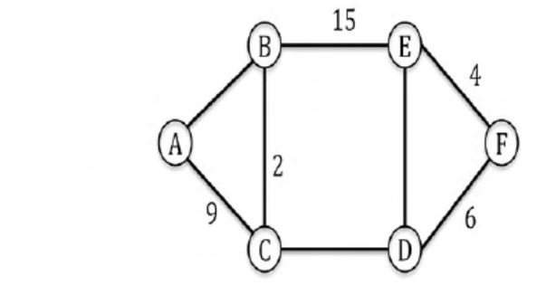

# 2015 CS1 Q63: Minimum total weight of a graph given its MST

## Question

The graph shown below has 8 edges with distinct integer edge weights. The minimum spanning tree (MST) is of weight 36 and contains the edges: $\lbrace$(A, C), (B, C), (B, E), (E, F), (D, F)$\rbrace$. The edge weights of only those edges which are in the MST are given in the figure shown below. The minimum possible sum of weights of all 8 edges of this graph is ______.

Answer

**69**

Solution

The three non-MST edges are $A$-$B$, $C$-$D$ and $D$-$E$. Each must be **heavier than every edge on the MST path** between its endpoints (cycle property), and all 8 weights are distinct integers. The MST edges use $9, 2, 15, 4, 6$.

| Non-MST edge | MST path between ends | Max on path | Smallest allowed |
|---|---|---|---|
| $A$-$B$ | $A$-$C$-$B$: 9, 2 | 9 | 10 |
| $C$-$D$ | $C$-$B$-$E$-$F$-$D$: 2, 15, 4, 6 | 15 | 16 |
| $D$-$E$ | $D$-$F$-$E$: 6, 4 | 6 | 7 |

The smallest allowed values $10, 16, 7$ are distinct from each other and from $\lbrace 9,2,15,4,6\rbrace$, so they can all be used.

$$36 + 10 + 16 + 7 = 69$$

**Key idea:** a non-tree edge must outweigh the maximum edge on the tree path joining its endpoints.

