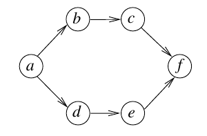

# 2016 CS1 Q11: Number of topological orderings of a six-vertex DAG

## Question

Consider the following directed graph:

Answer

**6**

Solution

The edges are $a \to b$, $b \to c$, $c \to f$, $a \to d$, $d \to e$, $e \to f$: two parallel chains from $a$ to $f$.

**Fixed ends.** $a$ has no incoming edge and every other vertex is reachable from it, so $a$ is first. Likewise $f$ is last.

**The middle four.** Two chains must be interleaved, each keeping its own order:

- chain 1: $b$ before $c$
- chain 2: $d$ before $e$

Choose which 2 of the 4 middle positions hold $b, c$ (the rest hold $d, e$ in order):

$$\binom{4}{2} = 6$$

The orderings are $abcdef$, $abdcef$, $abdecf$, $adbcef$, $adbecf$, $adebcf$.

**Code check:** enumerating all $720$ permutations of the six vertices and keeping those that respect every edge gave $6$.

**Key idea:** interleave two independent chains of length 2 between the fixed first and last vertices.

