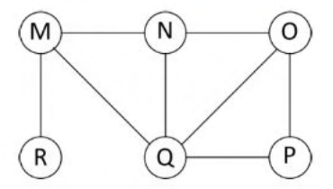

# 2017 CS2 Q15: A possible BFS visiting order on a six-node graph

## Question

The Breadth First Search (BFS) algorithm has been implemented using the queue data structure. Which one of the following is a possible order of visiting the nodes in the graph below?

- (A) MNOPQR
- (B) NQMPOR
- (C) QMNROP
- (D) POQNMR

Answer

**D**

Solution

**Edges read from the figure:** M–N, N–O, M–R, M–Q, N–Q, O–Q, O–P, Q–P.

**BFS rule.** Start at the first node. Then visit *all unvisited neighbours of the first node* (in any order), then all unvisited neighbours of the second visited node, and so on. So in a valid order, each node's newly found neighbours form a block placed right after the earlier blocks.

| Option | Start | Neighbours of start | Order says | Valid? |
|---|---|---|---|---|
| (A) MNOPQR | M | N, Q, R | next three are N, O, P | No: O and P are not neighbours of M |
| (B) NQMPOR | N | M, O, Q | next three are Q, M, P | No: P is not a neighbour of N |
| (C) QMNROP | Q | M, N, O, P | next four are M, N, R, O | No: R is not a neighbour of Q |
| (D) POQNMR | P | O, Q | next two are O, Q | Yes |

**Finish (D).** After P: O, Q are queued. Visit O: its unvisited neighbour is N. Visit Q: its unvisited neighbour is M (N is already seen). Then N has none. Then M gives R. Order: P, O, Q, N, M, R, which is (D).

**Code check:** a BFS-order validator (queue discipline, graph edges as above) accepted only `POQNMR`.

**Key idea:** in a BFS order, every node's unvisited neighbours appear together, before the neighbours of any later node.

