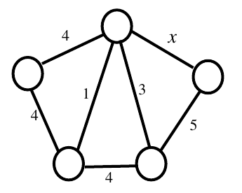

# 2018 CS Q57: Maximum number of minimum spanning trees over a free edge weight

## Question

Consider the following undirected graph $G$:

Choose a value for $x$ that will maximize the number of minimum weight spanning trees (MWSTs) of $G$. The number of MWSTs of $G$ for this value of $x$ is ______.

Answer

**4**

Solution

**Name the vertices:** $T$ (top), $L$ (left), $R$ (right), $B_1$ (bottom-left), $B_2$ (bottom-right). Edges: $TL=4$, $TR=x$, $TB_1=1$, $TB_2=3$, $LB_1=4$, $B_1B_2=4$, $B_2R=5$.

**Edges that are in every MWST:** weights 1 and 3 ($TB_1$ and $TB_2$) join $T, B_1, B_2$ with no cycle.

**$B_1B_2 = 4$ is never used:** with the edges 1 and 3 it forms a triangle in which 4 is the strict maximum.

**Attach $L$.** Two edges of weight 4 reach it, $TL$ and $LB_1$. Either can be used: **2 choices**.

**Attach $R$.** The candidates are $TR = x$ and $B_2R = 5$.
- $x < 5$: only $TR$ is cheapest, so 1 choice.
- $x > 5$: only $B_2R$ is cheapest, so 1 choice.
- $x = 5$: both cost 5 and either is minimal, so **2 choices**.

The number of MWSTs is $2\times$ (choices for $R$), maximised at $x = 5$:

$$2\times2 = 4$$

**Code check:** a brute-force count over all 4-edge subsets gave 2 MWSTs for $x\in\lbrace\tfrac12,1,2,3,\tfrac72,4,6,7\rbrace$ and **4** at $x=5$.

**Key idea:** ties among the cheapest edges that connect the same cut multiply the number of MSTs.

