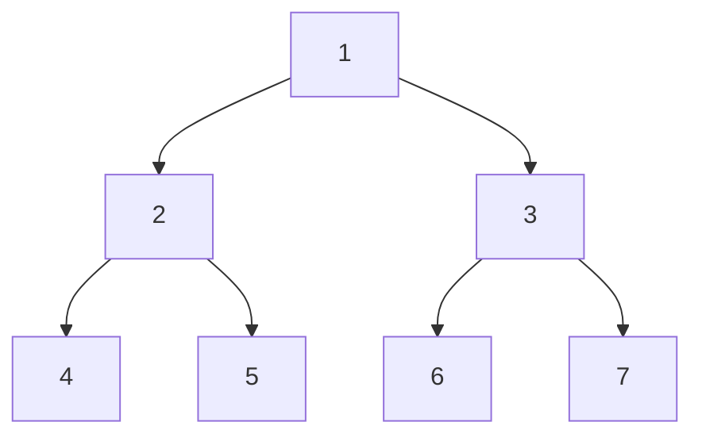

# 2021 CS2 Q26: First 3 vertices of BFS and DFS on a complete binary tree

## Question

Consider a complete binary tree with 7 nodes. Let $A$ denote the set of first 3 elements obtained by performing Breadth-First Search (BFS) starting from the root. Let $B$ denote the set of first 3 elements obtained by performing Depth-First Search (DFS) starting from the root.

The value of $|A-B|$ is ______.

Answer

**1**

Solution

Number the nodes level by level: root 1, children 2 and 3, leaves 4 to 7.

- **BFS** visits level by level: $A=\lbrace1,2,3\rbrace$.
- **DFS** goes down one branch first: $B=\lbrace1,2,4\rbrace$ (root, one child, that child's first child).

$A-B=\lbrace3\rbrace$, so $|A-B|=1$.

If DFS takes the right child first, then $B=\lbrace1,3,6\rbrace$ and $A-B=\lbrace2\rbrace$. The size is the same.

**Key idea:** BFS takes both children of the root; DFS takes one child and then that child's child, so exactly one vertex differs.

