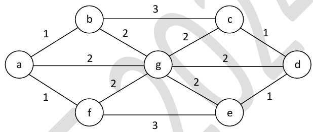

# 2024 CS2 Q59: Number of minimum spanning trees

## Question

The number of distinct minimum-weight spanning trees of the following graph is ________

Answer

**9**

Solution

**Kruskal's idea.** An MST uses the weight-1 edges first if they make no cycle, then weight-2, and so on.

**Weight 1 edges:** $a$-$b$, $a$-$f$, $c$-$d$, $d$-$e$. They form two paths with no cycle, so all four are forced. This leaves two groups: $\lbrace b, a, f \rbrace$ and $\lbrace c, d, e \rbrace$, plus the single vertex $g$. **Three components, so 2 more edges are needed.**

**Weight 2 edges** connect $g$ to the groups:

- to group $\lbrace b, a, f \rbrace$: $g$-$b$, $g$-$a$, $g$-$f$ (3 choices)
- to group $\lbrace c, d, e \rbrace$: $g$-$c$, $g$-$d$, $g$-$e$ (3 choices)

Pick one from each group: $3 \times 3 = 9$.

The weight-3 edges $b$-$c$ and $e$-$f$ are never needed.

Total MST weight $= 4 \times 1 + 2 \times 2 = 8$. A brute-force count over all 320 spanning trees also gave **9 trees of minimum weight 8**.

**Key idea:** with equal weights, count the independent choices Kruskal leaves open at each weight level.

