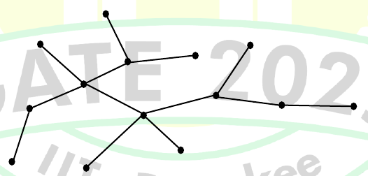
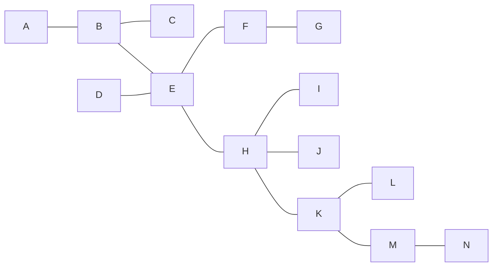

# 2025 CS2 Q59: Double BFS on a tree

## Question

Consider the following algorithm `someAlgo` that takes an undirected graph $G$ as input.

```
someAlgo(G)
  1. Let v be any vertex in G. Run BFS on G starting at v.
     Let u be a vertex in G at maximum distance from v
     as given by the BFS.
  2. Run BFS on G again with u as the starting vertex.
     Let z be the vertex at maximum distance from u
     as given by the BFS.
  3. Output the distance between u and z in G.
```

The output of `someAlgo(T)` for the tree shown in the given figure is ___________. (Answer in integer)



<details class="success" markdown="1">
<summary>Answer</summary>

**6**

</details>

<details class="info" markdown="1">
<summary>Solution</summary>

On a **tree**, this algorithm returns the **diameter**: the longest distance between any two vertices.

**Why it works.** From any start $v$, the farthest vertex $u$ is always an *end of some longest path*. A second BFS from $u$ then reaches the other end $z$ of that longest path, so the output is the diameter.

**Reading the tree** (14 vertices, 13 edges). I labelled the vertices $A$ to $N$ and redrew it:


*Redrawn from the figure. $E$, $H$, $K$ and $M$ form the main spine.*

Longest paths:

| Path | Edges |
|---|---|
| $G$-$F$-$E$-$H$-$K$-$M$-$N$ | 6 |
| $A$-$B$-$E$-$H$-$K$-$M$-$N$ | 6 |

No path is longer, so the diameter is **6**.

I put the tree into code, ran `someAlgo` from vertex $A$, and got $u = N$, $z = A$, distance 6.

**Key idea:** two BFS passes (farthest vertex, then farthest from that) find the diameter of a tree.

</details>
