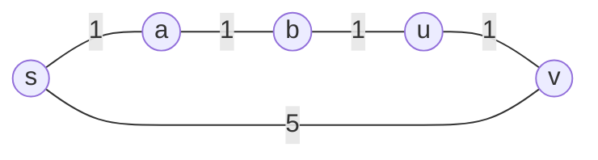

# 2026 CS1 Q41: Shortest paths with at most k edges

## Question

Let $G(V, E)$ be an undirected, edge-weighted graph with integer weights. The *weight* of a path is the sum of its edge weights. The *length* of a path is its number of edges.

Fix a vertex $s \in V$. For $u \in V$ and $k \ge 0$, let $d_k(u)$ be the weight of a minimum-weight path from $s$ to $u$ among paths of length **at most $k$**. If there is no such path, $d_k(u) = \infty$.

Consider the statements:

- **S1:** For every $k \ge 0$ and $u \in V$, $d_{k+1}(u) \le d_k(u)$.
- **S2:** For every $(u, v) \in E$, if $(u, v)$ is part of a shortest (minimum-weight) path from $s$ to $v$, then for every $k \ge 0$, $d_k(u) \le d_k(v)$.

Which one is correct?

- (A) Only S1 is true
- (B) Only S2 is true
- (C) Both S1 and S2 are true
- (D) Neither S1 nor S2 is true

Answer

**A**

Solution

**Refresher.** $d_k(u)$ is the quantity Bellman-Ford computes after $k$ rounds. It is the best weight you can get while using at most $k$ edges.

**S1 is true.** A path of length at most $k$ is also a path of length at most $k+1$. The set of allowed paths can only grow, so the minimum can only stay the same or drop:

$$d_{k+1}(u) \le d_k(u).$$

**S2 is false.** Being on the shortest path to $v$ does not mean $u$ is reachable with few edges. Take this graph, with $s$ the source:

- The shortest path to $v$ is $s \to a \to b \to u \to v$ with weight 4, and it uses the edge $(u, v)$.
- But it takes 4 edges. The direct edge $s \to v$ has weight 5 and only 1 edge.

Take $k = 1$:

- $d_1(u) = \infty$ ($u$ is 3 edges away),
- $d_1(v) = 5$.

So $d_1(u) \le d_1(v)$ is **false**.

| $k$ | $d_k(u)$ | $d_k(v)$ |
|---|---|---|
| 1 | $\infty$ | 5 |
| 2 | 6 | 5 |
| 3 | 3 | 5 |
| 4 | 3 | 4 |

At $k = 2$, $d_2(u) = 6$ (via $s \to v \to u$, weights $5 + 1$), which is also bigger than $d_2(v) = 5$. The claim only starts to hold from $k = 3$, so it fails for "every $k$".

**Verified.** I checked the counterexample by enumerating paths in Python, and tested S1 on 300 random graphs (it always held).

**Why the others fail:**

- **(B), (C)** both claim S2 is true. The counterexample breaks it.
- **(D)** claims S1 is false. S1 is true.

**Key idea:** "at most $k$ edges" and "minimum weight" are different measures. A vertex on the optimal path can still need more edges than a worse path.

