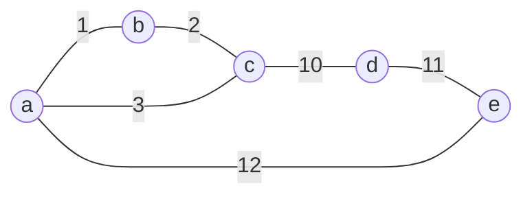

# 2026 CS1 Q49: Properties of MSTs with unique weights

## Question

Let $G(V, E)$ be a simple, undirected, edge-weighted graph with **unique** edge weights. Which of the following statements about the minimum spanning trees (MSTs) of $G$ is/are true?

- (A) In every cycle $C$ of $G$, the edge with the largest weight in $C$ is not in any MST.
- (B) In every cycle $C$ of $G$, the edge with the smallest weight in $C$ is in every MST.
- (C) For every vertex $v \in V$, the edge with the largest weight incident on $v$ is not in any MST.
- (D) For every vertex $v \in V$, the edge with the smallest weight incident on $v$ is in every MST.

Answer

**A and D**

Solution

**Refresher.** Two rules decide almost every MST question (with distinct weights):

- **Cycle property:** the heaviest edge on any cycle is in no MST.
- **Cut property:** for any split of the vertices into two groups, the lightest edge crossing the split is in every MST.

**(A) True.** This is exactly the cycle property.

**(D) True.** Take the cut $(\lbrace v \rbrace,\ V \setminus \lbrace v \rbrace)$. The edges crossing it are exactly the edges at $v$. The lightest one is in every MST by the cut property.

**(B) False.** The lightest edge of a cycle can still be the heaviest edge of a *different* cycle.

Example: triangle $a, b, c$ with $ab=1$, $bc=2$, $ac=3$, plus a cycle $a, c, d, e$ with $cd=10$, $de=11$, $ea=12$.

- In the cycle $a, c, d, e$ the smallest edge is $ac = 3$.
- But in the triangle $ac$ is the heaviest edge, so it is in no MST.
- The MST is $ab, bc, cd, de$, which does not contain $ac$.

**(C) False.** Take a vertex of degree 1 (a leaf). Its only edge is also its largest edge, but a spanning tree must include it to reach that vertex.

**Verified.** I generated 400 random graphs with unique weights and found every MST by trying all spanning trees. (A) and (D) held every time. (B) and (C) failed.

**Key idea:** the cycle property says which edge to throw away; the cut property says which edge you must keep. Per-vertex "smallest" edges are safe to keep, per-vertex "largest" edges are not safe to drop.

