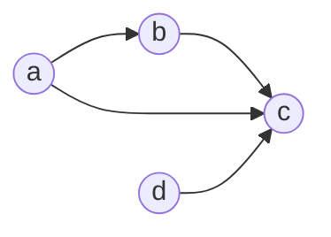

# 2026 CS1 Q50: DFS times on a DAG

## Question

Here is pseudocode for depth-first search on a directed graph $G(V, E)$. $d[v]$ and $f[v]$ are the discovery and finishing times of $v$.

```text
DFS(G):
  unmark all v in V
  t = 0
  for each v in V:
    if v is unmarked:
      t = Explore(G, v, t)

Explore(G, v, t):
  mark v
  t = t + 1
  d[v] = t
  for each (v, w) in E:
    if w is unmarked:
      t = Explore(G, w, t)
  t = t + 1
  f[v] = t
  return t
```

Suppose $G$ is a directed acyclic graph (DAG). For an edge $(u, v) \in E$, which of the following options will **NEVER** be correct?

- (A) $d[u] < d[v] < f[v] < f[u]$
- (B) $d[v] < d[u] < f[u] < f[v]$
- (C) $d[v] < f[v] < d[u] < f[u]$
- (D) $d[u] < d[v] < f[u] < f[v]$

<details class="success" markdown="1">
<summary>Answer</summary>

**B and D**

</details>

<details class="info" markdown="1">
<summary>Solution</summary>

**Refresher (parenthesis theorem).** For any two vertices, their intervals $[d, f]$ are either **disjoint** or one is **fully inside** the other. They can never partly overlap.

**Reading each option for the edge $u \to v$:**

| Option | Intervals | Meaning |
|---|---|---|
| A | $v$ inside $u$ | $v$ is a descendant of $u$ (tree or forward edge) |
| B | $u$ inside $v$ | $u$ is a descendant of $v$, so $v \to \dots \to u \to v$ is a cycle (back edge) |
| C | $v$ before $u$, disjoint | $v$ was finished earlier (cross edge) |
| D | partial overlap | impossible in any DFS |

**Option D never happens** in *any* graph, by the parenthesis theorem.

**Option B never happens in a DAG.** If $u$ is a descendant of $v$, there is a path $v \leadsto u$, and the edge $u \to v$ closes a cycle. A DAG has none.

**Options A and C are possible.** Example DAG, explored in order $a, b, c, d$:



| Vertex | $d$ | $f$ |
|---|---|---|
| a | 1 | 6 |
| b | 2 | 5 |
| c | 3 | 4 |
| d | 7 | 8 |

- Edge $a \to b$: $1 < 2 < 5 < 6$ gives option **A**.
- Edge $d \to c$: $3 < 4 < 7 < 8$ gives option **C**.

**Verified.** I ran this DFS on 3000 random DAGs with random vertex orders. Only patterns A and C ever occurred on edges.

**Key idea:** DFS intervals nest or are disjoint. In a DAG there are no back edges either, so only tree/forward (A) and cross (C) edges remain.

</details>
