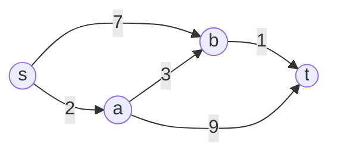

# 2026 CS2 Q37: Shortest paths in a weighted DAG

## Question

Let $G$ be a weighted directed acyclic graph with $m$ edges and $n$ vertices. Given $G$ and a source vertex $s$, which option gives the worst-case time complexity of the **fastest** algorithm to find the shortest-path lengths from $s$ to all vertices reachable from $s$?

- (A) $\Theta(m + n)$
- (B) $\Theta(m + n \log n)$
- (C) $\Theta(nm)$
- (D) $\Theta(n^3)$

<details class="success" markdown="1">
<summary>Answer</summary>

**A**

</details>

<details class="info" markdown="1">
<summary>Solution</summary>

**Idea.** In a DAG, vertices can be put in a topological order. If you process vertices in that order, then when you reach $v$, every vertex that can lead to $v$ has already been finished. So one pass of relaxations is enough.

```text
topologically sort G                 # O(n + m)
dist[s] = 0, dist[others] = infinity
for u in topological order:          # O(n)
    for each edge (u, v, w):         # O(m) in total
        dist[v] = min(dist[v], dist[u] + w)
```

Example: processing $s, a, b, t$ in order.



| Process | Relaxations | Distances so far |
|---|---|---|
| $s$ | $a = 2$, $b = 7$ | $a=2,\ b=7$ |
| $a$ | $b = \min(7, 2+3) = 5$, $t = 2+9 = 11$ | $b=5,\ t=11$ |
| $b$ | $t = \min(11, 5+1) = 6$ | $t=6$ |
| $t$ | none | final: $s=0,\ a=2,\ b=5,\ t=6$ |

Total time: $\Theta(n + m)$. Each vertex and edge is touched a constant number of times. Negative weights are fine too.

**Why the others fail:**

- **(B)** $\Theta(m + n \log n)$ is Dijkstra with a Fibonacci heap. It is slower than $O(m+n)$ and cannot handle negative weights.
- **(C)** $\Theta(nm)$ is Bellman-Ford, which does not use the DAG structure.
- **(D)** $\Theta(n^3)$ is Floyd-Warshall (all pairs). Far more than needed.

**Verified.** I compared the topological-order method with Bellman-Ford on 500 random DAGs with weights from $-5$ to $9$. The distances always matched.

**Key idea:** a DAG has a topological order, which makes relaxation order known in advance and removes the need for a priority queue.

</details>
