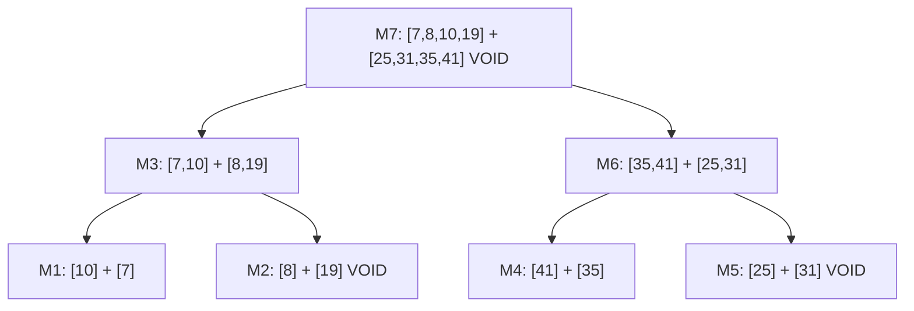

# 2026 CS2 Q32: Void merges in merge sort

## Question

Consider the array $A = [10, 7, 8, 19, 41, 35, 25, 31]$. Merge sort is run on $A$ to sort it in increasing order, and it carries out a total of 7 merge operations.

A merge operation on sorted left array $L$ and sorted right array $R$ is called **void** if its output is the elements of $L$ followed by the elements of $R$ (that is, nothing moves).

The number of void merge operations among these 7 is _____. (answer in integer)

Answer

**3**

Solution

**Refresher.** Merge sort splits the array in half, sorts each half, then merges. A merge is void exactly when every element of $L$ is at most every element of $R$, i.e. $\max(L) \le \min(R)$.

**Merge tree.** M1 to M7 are the 7 merges, in the order they happen.

**Step by step (bottom level first).**

| Merge | Left | Right | Output | Void? |
|---|---|---|---|---|
| M1 | [10] | [7] | [7, 10] | no, 10 > 7 |
| M2 | [8] | [19] | [8, 19] | **yes** |
| M3 | [7, 10] | [8, 19] | [7, 8, 10, 19] | no, 10 > 8 |
| M4 | [41] | [35] | [35, 41] | no, 41 > 35 |
| M5 | [25] | [31] | [25, 31] | **yes** |
| M6 | [35, 41] | [25, 31] | [25, 31, 35, 41] | no, 35 > 25 |
| M7 | [7, 8, 10, 19] | [25, 31, 35, 41] | sorted | **yes**, 19 < 25 |

Void merges: M2, M5 and M7, so the answer is **3**.

**Verified** by simulating merge sort in Python (7 merges, 3 void).

**Key idea:** a merge is void when $\max(L) \le \min(R)$. Check this at each node of the merge tree.

