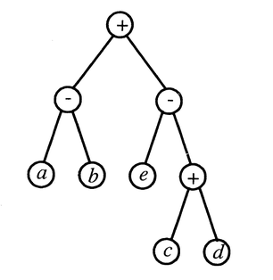

# 2011 CS Q36: Minimum registers to evaluate an expression tree

## Question

Consider evaluating the following expression tree on a machine with load-store architecture in which memory can be accessed only through load and store instructions. The variables $a$, $b$, $c$, $d$ and $e$ are initially stored in memory. The binary operators used in this expression tree can be evaluated by the machine only when the operands are in registers. The instructions produce result only in a register. If no intermediate results can be stored in memory, what is the minimum number of registers needed to evaluate this expression?

- (A) 2
- (B) 9
- (C) 5
- (D) 3

Answer

**D**

Solution

The tree is $(a - b) + (e - (c + d))$. Every leaf must be loaded into a register before use, and an operation can write its result over one of its operand registers.

For a node, evaluate the child that needs **more** registers first, so that only one register (the finished result) is held while the other child is evaluated.

| Subtree | Registers needed |
|---|---|
| leaf | $1$ |
| $a - b$ | $2$ (load $a$, load $b$) |
| $c + d$ | $2$ |
| $e - (c + d)$ | do $c + d$ first ($2$ registers, result in $1$), then load $e$: needs $\max(2, 1 + 1) = 2$ |
| root $+$ | do one side first (result held in $1$ register), then the other needs $2$: $\max(2, 1 + 2) = 3$ |

So the minimum is $3$ registers: (D).

- (A) $2$ is not enough: while the second subtree uses $2$ registers, the first result must still be held.
- (B) $9$ and (C) $5$ are more than needed; $3$ suffice.

**Code check:** the recurrence $\min(\max(l, 1 + r), \max(r, 1 + l))$ over the tree gave $3$.

**Key idea:** with load-store operands, a node with two equal-need children needs one more register than each child (Sethi-Ullman).

