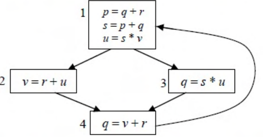

# 2015 CS1 Q46: Variables live at two statements of a control flow graph

## Question

A variable $x$ is said to be live at a statement $S_i$ in a program if the following three conditions hold simultaneously:

- i. There exists a statement $S_j$ that uses $x$
- ii. There is a path from $S_i$ to $S_j$ in the flow graph corresponding to the program
- iii. The path has no intervening assignment to $x$ including at $S_i$ and $S_j$

The variables which are live both at the statement in basic block 2 and at the statement in basic block 3 of the above control flow graph are

- (A) $p, s, u$
- (B) $r, s, u$
- (C) $r, u$
- (D) $q, v$

Answer

**C**

Solution

Compute the live variables at the statement of each block by backward flow.

**Block 2** (`v = r + u`, then goes to block 4). From block 2 the paths run $2 \to 4 \to 1 \to \dots$

- Uses $r$ and $u$ immediately: live.
- $v$ is assigned at the statement itself: not live.
- $q$ is assigned in block 4 before block 1 reads it: not live.
- $p$ and $s$ are assigned in block 1 before being read: not live.

Live at 2: $\lbrace r, u\rbrace$.

**Block 3** (`q = s * u`, then goes to block 4).

- Uses $s$ and $u$ immediately: live.
- Block 4 (`q = v + r`) uses $v$ and $r$ with no assignment on the path: live.
- $q$ is assigned here: not live.

Live at 3: $\lbrace s, u, v, r\rbrace$.

Live at both: $\lbrace r, u\rbrace$. Option (C). (A) and (B) include $s$ or $p$, which are not live at block 2. (D) has $q$ (not live anywhere here) and $v$ (not live at block 2).

**Key idea:** $\text{live-in} = \text{use} \cup (\text{live-out} - \text{def})$, computed backwards over the flow graph.

