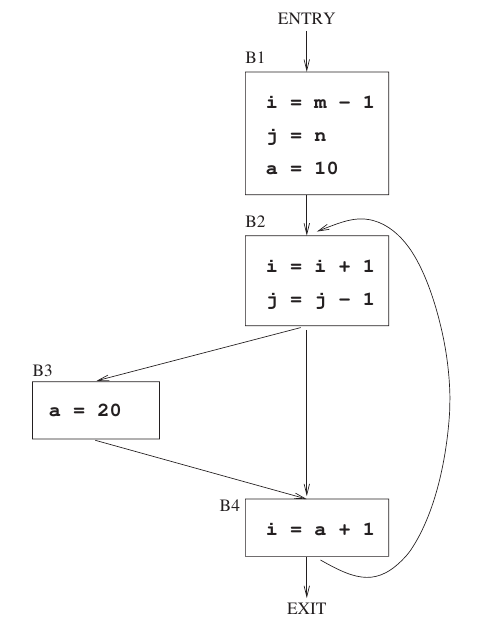

# 2023 CS Q37: Live variables at block exits

## Question

Consider the control flow graph shown.

Which one of the following choices correctly lists the set of *live* variables at the exit point of each basic block?

- (A) B1: $\lbrace\rbrace$, B2: $\lbrace$a$\rbrace$, B3: $\lbrace$a$\rbrace$, B4: $\lbrace$a$\rbrace$
- (B) B1: $\lbrace$i, j$\rbrace$, B2: $\lbrace$a$\rbrace$, B3: $\lbrace$a$\rbrace$, B4: $\lbrace$i$\rbrace$
- (C) B1: $\lbrace$a, i, j$\rbrace$, B2: $\lbrace$a, i, j$\rbrace$, B3: $\lbrace$a, i$\rbrace$, B4: $\lbrace$a$\rbrace$
- (D) B1: $\lbrace$a, i, j$\rbrace$, B2: $\lbrace$a, j$\rbrace$, B3: $\lbrace$a, j$\rbrace$, B4: $\lbrace$a, i, j$\rbrace$

Answer

**D**

Solution

**Rule.** $\text{out}(B) = \bigcup \text{in}(S)$ over successors $S$, and $\text{in}(B) = \text{use}(B) \cup (\text{out}(B) - \text{def}(B))$.

**Per block** (the variables that matter are $a$, $i$, $j$):

| Block | use | def |
|---|---|---|
| B1 | none | $i, j, a$ |
| B2 | $i, j$ | $i, j$ |
| B3 | none | $a$ |
| B4 | $a$ | $i$ |

**Solve backwards, repeating until nothing changes** (B4 feeds back to B2, so a loop is involved):

- $\text{in}(B4) = \lbrace a \rbrace \cup (\text{out}(B4) - \lbrace i \rbrace)$
- $\text{out}(B4) = \text{in}(B2) = \lbrace i, j \rbrace \cup (\text{out}(B2) - \lbrace i, j \rbrace)$
- $\text{out}(B3) = \text{in}(B4) = \lbrace a, j \rbrace$
- $\text{out}(B2) = \text{in}(B3) \cup \text{in}(B4) = \lbrace j \rbrace \cup \lbrace a, j \rbrace = \lbrace a, j \rbrace$
- $\text{in}(B2) = \lbrace a, i, j \rbrace$, so $\text{out}(B1) = \text{out}(B4) = \lbrace a, i, j \rbrace$

**Result:** B1: $\lbrace a,i,j \rbrace$, B2: $\lbrace a,j \rbrace$, B3: $\lbrace a,j \rbrace$, B4: $\lbrace a,i,j \rbrace$. This is **D**.

**Code check:** a small iterative data-flow program gave the same four sets.

**Why the others fail:**
- **A** and **B** miss variables that are used later: $a$ is read in B4, and $i, j$ are read when the loop returns to B2.
- **C** calls $i$ live after B2 and B3, but B4 overwrites $i$ before any read. It also drops $j$ from B3's exit and drops $i, j$ from B4's exit, though B2 reads them on the next iteration.

**Key idea:** liveness is a backward data-flow problem: a variable is live if some path uses it before redefining it.

