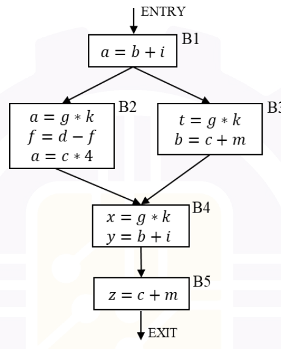

# 2026 CS1 Q42: Redundant expressions in a control flow graph

## Question

Consider the control flow graph shown in the figure.

Which one of the following options correctly lists the set of redundant expressions (common subexpressions) in the basic blocks B4 and B5? (All variables are integers.)

- (A) B4: $\lbrace b+i \rbrace$, B5: $\lbrace c+m \rbrace$
- (B) B4: $\lbrace g*k \rbrace$, B5: $\lbrace c+m \rbrace$
- (C) B4: $\lbrace g*k,\ b+i \rbrace$, B5: $\lbrace \rbrace$
- (D) B4: $\lbrace g*k \rbrace$, B5: $\lbrace \rbrace$

Answer

**D**

Solution

**Refresher.** An expression in a block is **redundant** if it is *available* on entry: on **every** path to the block it was computed and its operands were not changed afterwards. At a join point, take the **intersection** over all incoming paths.

**Expressions available at the end of each block** (an assignment to a variable kills every expression that uses that variable):

| Block | Computed | Killed | Available at exit |
|---|---|---|---|
| B1 | $b+i$ | none | $b+i$ |
| B2 | $g*k$, $d-f$, $c*4$ | $d-f$ is killed because $f$ is assigned | $b+i$, $g*k$, $c*4$ |
| B3 | $g*k$, $c+m$ | $b+i$ is killed because $b$ is assigned | $g*k$, $c+m$ |

**B4 entry** = (B2 exit) $\cap$ (B3 exit) = $\lbrace g*k \rbrace$.

- $g*k$ is available on both paths, so in B4 it is **redundant**.
- $b+i$ is **not** available via B3, because B3 changed $b$. So $b+i$ is recomputed, not redundant.

**B5 entry** = B4 exit = $\lbrace g*k,\ b+i \rbrace$ (B4 computes $g*k$ and $b+i$).

- $c+m$ is **not** in this set (it was computed only on the B3 path, and not on the B2 path). So $c+m$ in B5 is not redundant.

So the answer is B4: $\lbrace g*k \rbrace$, B5: $\lbrace \rbrace$.

**Why the others fail:**

- **(A)** and **(C)** include $b+i$ in B4, but B3 kills it.
- **(A)** and **(B)** include $c+m$ in B5, but it is computed only on one of the two paths into B4.

**Verified** by running an available-expressions analysis in Python on this graph.

**Key idea:** available expressions use *intersection* at joins, and any assignment to an operand kills the expression.

