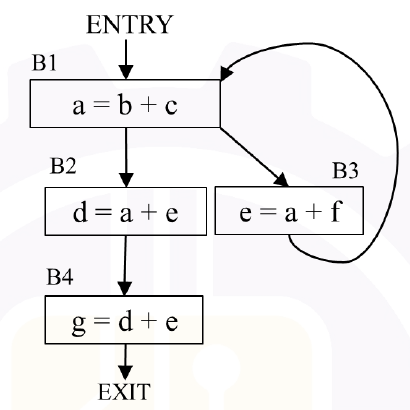

# 2026 CS2 Q45: Live variables at the exit of each basic block

## Question

Consider the control flow graph given below.

Which one of the following options is the set of live variables at the exit point of each basic block?

- (A) B1: $\lbrace a,b,c,e,f \rbrace$, B2: $\lbrace d,e \rbrace$, B3: $\lbrace b,c,e,f \rbrace$, B4: $\emptyset$
- (B) B1: $\emptyset$, B2: $\lbrace d,e \rbrace$, B3: $\lbrace a,c,f \rbrace$, B4: $\emptyset$
- (C) B1: $\lbrace a,b,c,e,f \rbrace$, B2: $\lbrace d,e \rbrace$, B3: $\lbrace c,e,f \rbrace$, B4: $\emptyset$
- (D) B1: $\emptyset$, B2: $\lbrace d,e,f \rbrace$, B3: $\lbrace a,b,c,e,f \rbrace$, B4: $\emptyset$

Answer

**A**

Solution

**Refresher.** A variable is **live** at a point if its current value may be read later before being overwritten. It is a *backward* analysis:

$$OUT[B] = \bigcup_{S \in succ(B)} IN[S], \qquad IN[B] = use[B] \cup (OUT[B] - def[B]).$$

**Blocks.**

| Block | use | def |
|---|---|---|
| B1: $a = b+c$ | $b, c$ | $a$ |
| B2: $d = a+e$ | $a, e$ | $d$ |
| B3: $e = a+f$ | $a, f$ | $e$ |
| B4: $g = d+e$ | $d, e$ | $g$ |

**Solve (the loop B3 to B1 needs iteration).**

- $OUT[B4] = \emptyset$, so $IN[B4] = \lbrace d, e \rbrace$.
- $OUT[B2] = IN[B4] = \lbrace d, e \rbrace$, so $IN[B2] = \lbrace a, e \rbrace$.
- $OUT[B3] = IN[B1]$ and $IN[B3] = (IN[B1] - \lbrace e \rbrace) \cup \lbrace a, f \rbrace$.
- $OUT[B1] = IN[B2] \cup IN[B3]$ and $IN[B1] = (OUT[B1] - \lbrace a \rbrace) \cup \lbrace b, c \rbrace$.

Start with $IN[B3] = \lbrace a, f \rbrace$, then:

| Pass | $OUT[B1]$ | $IN[B1]$ | $IN[B3]$ |
|---|---|---|---|
| 1 | $\lbrace a, e, f \rbrace$ | $\lbrace b, c, e, f \rbrace$ | $\lbrace a, b, c, f \rbrace$ |
| 2 | $\lbrace a, b, c, e, f \rbrace$ | $\lbrace b, c, e, f \rbrace$ | $\lbrace a, b, c, f \rbrace$ |

Stable. Then $OUT[B3] = IN[B1] = \lbrace b, c, e, f \rbrace$.

**Live at exit:** B1: $\lbrace a,b,c,e,f \rbrace$, B2: $\lbrace d,e \rbrace$, B3: $\lbrace b,c,e,f \rbrace$, B4: $\emptyset$. This is **(A)**.

**Why the others fail:** (B) and (D) give B1 an empty set, but $a$ is used in B2 and B3 right after B1. (C) drops $b$ from B3's exit, but $b$ is used in B1 on the next iteration.

**Verified** by solving the data-flow equations iteratively in Python.

**Key idea:** liveness flows backwards, and a loop forces you to iterate until nothing changes.

