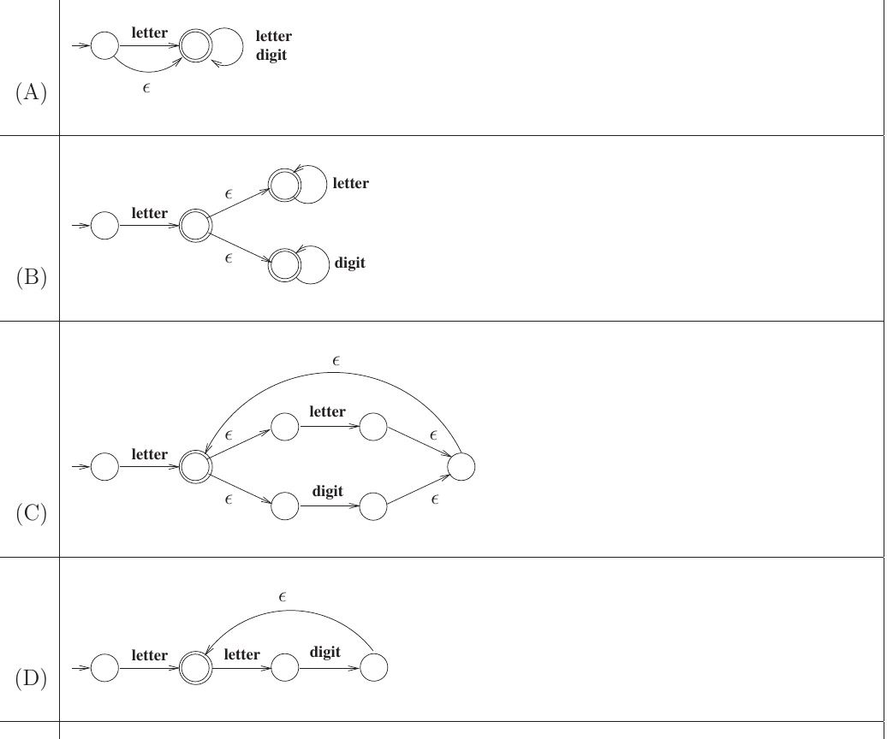

# 2023 CS Q19: NFA for an identifier token

## Question

Consider the following definition of a lexical token **id** for an identifier in a programming language, using extended regular expressions:

$$\text{letter} \to [\text{A-Za-z}]$$
$$\text{digit} \to [\text{0-9}]$$
$$\text{id} \to \text{letter}\,(\text{letter} \mid \text{digit})^*$$

Which one of the following Non-deterministic Finite-state Automata with $\epsilon$-transitions accepts the set of valid identifiers? (A double-circle denotes a final state)

Answer

**C**

Solution

**Target:** a letter first, then any mix of letters and digits, in any order, any number of times.

**Option C (correct).** After the first `letter` we reach the final state. From there two $\epsilon$-branches read one `letter` or one `digit`, join, and an $\epsilon$-edge returns to the final state. This loop can be repeated in any order, and stopping at the final state is always allowed.

**Why the others fail:**
- **A**: an $\epsilon$-edge goes from the start state straight to the final state, so the empty string and strings starting with a digit are accepted.
- **B**: after the first letter you go to a state that loops on *only* letters or *only* digits, so strings like `a1b` are rejected.
- **D**: the loop is `letter digit` as a pair, so `ab` (letter, letter, letter) is rejected.

**Key idea:** $(\text{letter}\mid\text{digit})^*$ needs a loop with a choice inside it that returns to the final state.

