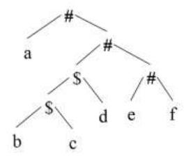

# 2018 CS Q48: Precedence and associativity from a parse tree

## Question

Consider the following parse tree for the expression `a#b$c$d#e#f`, involving two binary operators `$` and `#`.

Which one of the following is correct for the given parse tree?

- (A) $ has higher precedence and is left associative; # is right associative
- (B) # has higher precedence and is left associative; $ is right associative
- (C) $ has higher precedence and is left associative; # is left associative
- (D) # has higher precedence and is right associative; $ is left associative

Answer

**A**

Solution

**Read the tree as brackets:**

$$a\ \#\ \big(\,((b\ \$\ c)\ \$\ d)\ \#\ (e\ \#\ f)\,\big)$$

- **Precedence.** The `$` groups are *inside* the `#` operands, so `$` binds tighter: `$` has higher precedence.
- **`$` associativity.** $b\$c$ is evaluated first, then $(b\$c)\$d$: grouping from the left, so `$` is **left** associative.
- **`#` associativity.** $a\#(\ldots)$ and $\ldots\#(e\#f)$: each `#` has the remaining chain on its right, so `#` is **right** associative.

This matches **A**.

**Why the others fail:** B and D give `#` the higher precedence. C calls `#` left associative.

**Key idea:** operators deeper in the tree bind tighter; the side where the chain nests shows associativity.

