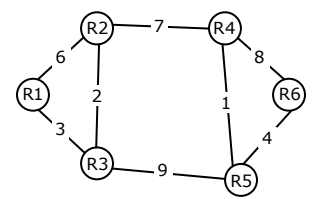

# 2010 CS Q54: Links never used once distance vector routing converges

## Question

**Linked Answer Questions 54 and 55.**

Consider a network with $6$ routers R1 to R6 connected with links having weights as shown in the following diagram.

All the routers use the distance vector based routing algorithm to update their routing tables. Each router starts with its routing table initialized to contain an entry for each neighbour with the weight of the respective connecting link. After all the routing tables stabilize, how many links in the network will never be used for carrying any data?

- (A) $4$
- (B) $3$
- (C) $2$
- (D) $1$

*The key in the supplied PDF prints this answer as a lowercase "c"; I read it as C.*

Answer

**C**

Solution

Once the tables stabilize, each router sends data along a shortest path. A link is unused if it is on **no** shortest path between any pair of routers.

Check each link against the best alternative route:

| Link (weight) | Alternative route | Alternative cost | Used? |
|---|---|---|---|
| R1-R2 ($6$) | R1-R3-R2 | $3 + 2 = 5$ | **no** |
| R4-R6 ($8$) | R4-R5-R6 | $1 + 4 = 5$ | **no** |
| R2-R4 ($7$) | R2-R3-R5-R4 | $2 + 9 + 1 = 12$ | yes |
| R3-R5 ($9$) | R3-R2-R4-R5 | $2 + 7 + 1 = 10$ | yes |
| R1-R3, R2-R3, R4-R5, R5-R6 | no shorter alternative | | yes |

Two links are never used: R1-R2 and R4-R6: (C).

- R3-R5 and R2-R4 are each the unique shortest route for some pair of routers, so they are used. (A) and (B) would need more than two unused links, and (D) would need fewer.

**Code check:** a Python script (networkx) found, for every router pair, all shortest paths and took the union of their links. Unused links: R1-R2 and R4-R6. No pair had tied shortest paths, so distance vector gives the same result.

**Key idea:** a link is used only if it lies on some shortest path; a link longer than a detour between its ends is never used.

