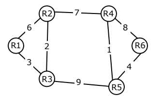

# 2010 CS Q55: Unused links after setting the unused link weights to 2

## Question

**Linked Answer Questions 54 and 55** (same network as Question 54).

Suppose the weights of all unused links in the previous question are changed to $2$ and the distance vector algorithm is used again until all routing tables stabilize. How many links will now remain unused?

- (A) $0$
- (B) $1$
- (C) $2$
- (D) $3$

Answer

**B**

Solution

The unused links from Question 54 were R1-R2 and R4-R6. Both now have weight $2$.

- R1-R2 ($2$) is now shorter than R1-R3-R2 ($3 + 2 = 5$), so it is used.
- R4-R6 ($2$) is now shorter than R4-R5-R6 ($1 + 4 = 5$), so it is used.

But the cheaper R4-R6 link now makes R5-R6 ($4$) redundant: R5-R4-R6 costs $1 + 2 = 3 < 4$. So R5-R6 is **unused**.

The remaining links are still the only shortest route for some pair (for example R3-R5 at $9$ against $2 + 7 + 1 = 10$, and R2-R4 at $7$ against $2 + 9 + 1 = 12$).

One link is unused: (B).

- (A) $0$ ignores the new redundancy of R5-R6.
- (C) and (D) count links that are still on a shortest path.

**Code check:** the same shortest-path script, run with R1-R2 and R4-R6 set to $2$, leaves only R5-R6 unused. No pair has tied shortest paths.

**Key idea:** lowering a weight can make a link that was used before redundant.

