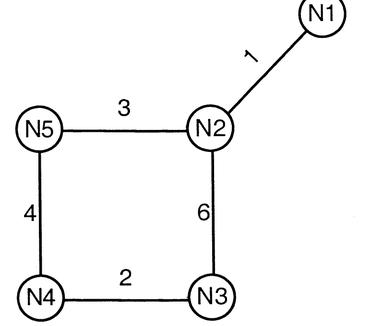

# 2011 CS Q52: Distance vector of N3 after a link cost drops

## Question

**Linked Answer Questions 52 and 53.**

Consider a network with five nodes, N1 to N5, as shown below.

The network uses a Distance Vector Routing protocol. Once the routes have stabilized, the distance vectors at different nodes are as following.

- N1: (0, 1, 7, 8, 4)
- N2: (1, 0, 6, 7, 3)
- N3: (7, 6, 0, 2, 6)
- N4: (8, 7, 2, 0, 4)
- N5: (4, 3, 6, 4, 0)

Each distance vector is the distance of the best known path at that instance to nodes, N1 to N5, where the distance to itself is 0. Also, all links are symmetric and the cost is identical in both directions. In each round, all nodes exchange their distance vectors with their respective neighbors. Then all nodes update their distance vectors. In between two rounds, any change in cost of a link will cause the two incident nodes to change only that entry in their distance vectors.

The cost of link N2-N3 reduces to 2 (in both directions). After the next round of updates, what will be the new distance vector at node, N3?

- (A) (3, 2, 0, 2, 5)
- (B) (3, 2, 0, 2, 6)
- (C) (7, 2, 0, 2, 5)
- (D) (7, 2, 0, 2, 6)

Answer

**A**

Solution

**Before the round.** Only the two ends of the changed link update, and only that entry: N3's entry for N2 becomes $2$ (so N3 $= (7, 2, 0, 2, 6)$) and N2's entry for N3 becomes $2$ (N2 $= (1, 0, 2, 7, 3)$).

**The round.** N3's neighbors are N2 (link cost $2$) and N4 (link cost $2$). Each entry is the minimum over the neighbors of (link cost $+$ the neighbor's advertised distance):

| To | via N2: $2 + N2[\cdot]$ | via N4: $2 + N4[\cdot]$ | New |
|---|---|---|---|
| N1 | $2 + 1 = 3$ | $2 + 8 = 10$ | $3$ |
| N2 | $2 + 0 = 2$ | $2 + 7 = 9$ | $2$ |
| N3 | | | $0$ |
| N4 | $2 + 7 = 9$ | $2 + 0 = 2$ | $2$ |
| N5 | $2 + 3 = 5$ | $2 + 4 = 6$ | $5$ |

New vector at N3: $(3, 2, 0, 2, 5)$: (A).

- (B) keeps N5 at $6$; the path N3-N2-N5 now costs $2 + 3 = 5$.
- (C) keeps N1 at $7$; the path N3-N2-N1 now costs $2 + 1 = 3$.
- (D) is the vector before the round, with only the entry for N2 changed.

**Code check:** a synchronous distance-vector simulation of the round gave N3 $= (3, 2, 0, 2, 5)$.

**Key idea:** after a link cost change, each node recomputes every entry as the minimum over neighbors of link cost plus the neighbor's advertised distance.

