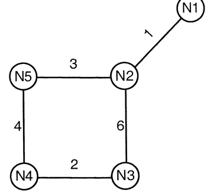

# 2011 CS Q53: Cost from N3 to N1 after the N1-N2 link fails

## Question

**Linked Answer Questions 52 and 53.**

Consider a network with five nodes, N1 to N5, as shown below.

The network uses a Distance Vector Routing protocol. Once the routes have stabilized, the distance vectors at different nodes are as following.

- N1: (0, 1, 7, 8, 4)
- N2: (1, 0, 6, 7, 3)
- N3: (7, 6, 0, 2, 6)
- N4: (8, 7, 2, 0, 4)
- N5: (4, 3, 6, 4, 0)

Each distance vector is the distance of the best known path at that instance to nodes, N1 to N5, where the distance to itself is 0. Also, all links are symmetric and the cost is identical in both directions. In each round, all nodes exchange their distance vectors with their respective neighbors. Then all nodes update their distance vectors. In between two rounds, any change in cost of a link will cause the two incident nodes to change only that entry in their distance vectors.

After the update in the previous question, the link N1-N2 goes down. N2 will reflect this change immediately in its distance vector as cost, $\infty$. After the **NEXT ROUND** of update, what will be the cost to N1 in the distance vector of N3?

- (A) 3
- (B) 9
- (C) 10
- (D) $\infty$

Answer

**C**

Solution

**State after Q52's round.** All nodes updated at the same time using the previous vectors:

| Node | Vector |
|---|---|
| N1 | $(0, 1, 3, 8, 4)$ |
| N2 | $(1, 0, 2, 4, 3)$ |
| N3 | $(3, 2, 0, 2, 5)$ |
| N4 | $(8, 4, 2, 0, 4)$ |
| N5 | $(4, 3, 5, 4, 0)$ |

**The link N1-N2 goes down.** N2 sets its entry for N1 to $\infty$ and N1 sets its entry for N2 to $\infty$: N2 $= (\infty, 0, 2, 4, 3)$.

**Next round.** N3 recomputes its distance to N1 from its neighbors' advertisements:

- via N2 (cost $2$): $2 + \infty = \infty$
- via N4 (cost $2$): $2 + 8 = 10$ (N4 still advertises $8$ for N1)

So N3's cost to N1 becomes $\min(\infty, 10) = 10$: (C).

- (A) $3$ is the old value. N3 does not keep it, because it was learned through N2 and N2 now advertises $\infty$.
- (B) $9$ matches no path advertised in this round.
- (D) $\infty$ would need N4 to advertise $\infty$ too, but N4 has not heard of the failure yet.

N1 is now unreachable, so $10$ is a temporary wrong value (the count-to-infinity effect of distance vector routing).

**Code check:** the simulation of both rounds gave N3 $= (10, 2, 0, 2, 5)$ after the second round.

**Key idea:** a distance-vector node recomputes from its neighbors' current advertisements, so a stale path through a failed link is replaced by the next best advertised one (here via N4).

