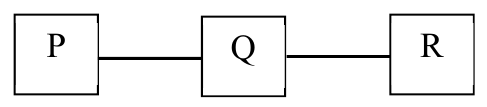

# 2022 CS Q57: Count-to-infinity loop probability

## Question

Consider a network with three routers P, Q, R shown in the figure below. All the links have cost of unity.

The routers exchange distance vector routing information and have converged on the routing tables, after which the link Q−R fails. Assume that P and Q send out routing updates at random times, each at the same average rate. The probability of a routing loop formation (rounded off to one decimal place) between P and Q, leading to count-to-infinity problem, is ______.

Answer

**0.5**

Solution

**Before the failure:** Q reaches R at cost 1, and P reaches R through Q at cost 2.

**After Q−R fails,** Q knows R is unreachable. Two updates compete:

- If Q sends its new vector to P first, P learns R is unreachable. No loop.
- If P sends its old vector (R at cost 2) to Q first, Q believes it can reach R through P at cost 3. Q then sends that to P, P raises its cost to 4, and so on. This is the count-to-infinity loop between P and Q.

**Probability.** P and Q update at random times at the same rate, so each is equally likely to send first:

$$P(\text{loop}) = \tfrac12 = 0.5$$

**Code check:** simulating two independent exponential timers (equal rates) gave $P(\text{P first}) \approx 0.50$.

**Key idea:** count-to-infinity starts when the neighbour's stale route reaches the failed router before its own failure news does; with equal rates this is a coin flip.

**Assumption:** the answer depends on the "equal chance of going first" model above, which is how the key reads the question.

