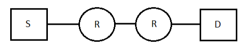

# 2013 CS Q14: Layer visits from S to D

## Question

Assume that source S and destination D are connected through two intermediate routers labeled R. Determine how many times each packet has to visit the network layer and the data link layer during a transmission from S to D.

- (A) Network layer - 4 times and Data link layer - 4 times
- (B) Network layer - 4 times and Data link layer - 3 times
- (C) Network layer - 4 times and Data link layer - 6 times
- (D) Network layer - 2 times and Data link layer - 6 times

Answer

**C**

Solution

**Network layer.** It is implemented at every node on the path: S, R, R and D. That is **4** visits.

**Data link layer.** It works per link. There are 3 links (S-R, R-R, R-D). On each link the packet is framed by the sender's data link layer and de-framed by the receiver's: $3 \times 2 = $ **6** visits.

| Node | Network | Data link |
|---|---|---|
| S | 1 | 1 (send) |
| R1 | 1 | 2 (receive, send) |
| R2 | 1 | 2 (receive, send) |
| D | 1 | 1 (receive) |
| Total | 4 | 6 |

**Why the others fail:**

- (A), (B) count the data link layer once per node or once per link, missing that each link has two ends.
- (D) counts network layer only at the end hosts; routers also run it (they forward by IP).

**Key idea:** the network layer is end-to-end through routers; the data link layer is hop-by-hop and used at both ends of each link.

