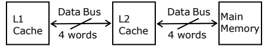

# 2010 CS Q48: Time to move an L1 block from L2 on an L1 miss, L2 hit

## Question

**Common Data Questions 48 and 49.**

A computer system has an L1 cache, an L2 cache, and a main memory unit connected as shown below. The block size in L1 cache is $4$ words. The block size in L2 cache is $16$ words. The memory access times are $2$ nanoseconds, $20$ nanoseconds and $200$ nanoseconds for L1 cache, L2 cache and main memory unit respectively.

When there is a miss in L1 cache and a hit in L2 cache, a block is transferred from L2 cache to L1 cache. What is the time taken for this transfer?

- (A) $2$ nanoseconds
- (B) $20$ nanoseconds
- (C) $22$ nanoseconds
- (D) $88$ nanoseconds

Answer

**D**

Solution

**Status: disputed.** The official key in the supplied PDF is (D) $88$ ns. My own reading gives (C) $22$ ns. Both follow.

**What I get (C).** An L1 block is $4$ words and the bus between L2 and L1 carries $4$ words at a time, so the block moves in **one** transfer. That transfer reads L2 ($20$ ns) and writes L1 ($2$ ns):

$$20 + 2 = 22 \text{ ns}$$

**What the key assumes (D).** The block moves as $4$ separate transfers of $22$ ns each:

$$4 \times (20 + 2) = 88 \text{ ns}$$

That treats the bus as one word wide, which conflicts with the "$4$ words" label on the bus in the figure. The key is also inconsistent with itself across Q48 and Q49 (see Q49), where the memory-to-L2 transfers are counted as $4$-word transfers. I record the key and flag the conflict.

- (A) $2$ ns is the L1 write time alone; the L2 read is missing.
- (B) $20$ ns is the L2 read alone; the L1 write is missing.

**Code check:** arithmetic only ($20 + 2 = 22$, $4 \times 22 = 88$). No program to run.

**Key idea:** transfer count is block size divided by bus width; each transfer costs the read time of the lower level plus the write time of the upper level.

