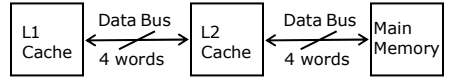

# 2010 CS Q49: Total time for an L1 and L2 miss, block moved from memory to L2 to L1

## Question

**Common Data Questions 48 and 49** (same system and figure as Question 48).

When there is a miss in both L1 cache and L2 cache, first a block is transferred from main memory to L2 cache, and then a block is transferred from L2 cache to L1 cache. What is the total time taken for these transfers?

- (A) $222$ nanoseconds
- (B) $888$ nanoseconds
- (C) $902$ nanoseconds
- (D) $968$ nanoseconds

Answer

**D**

Solution

**Status: disputed.** The official key in the supplied PDF is (D) $968$ ns. My own reading gives (C) $902$ ns. Both follow.

**Memory to L2 (both readings).** An L2 block is $16$ words and the bus carries $4$ words, so there are $16/4 = 4$ transfers. Each reads memory ($200$ ns) and writes L2 ($20$ ns):

$$4 \times (200 + 20) = 880 \text{ ns}$$

**L2 to L1.**

- **My reading:** one $4$-word transfer, $20 + 2 = 22$ ns. Total $880 + 22 = 902$ ns, (C).
- **Key's reading:** four transfers of $22$ ns, $88$ ns. Total $880 + 88 = 968$ ns, (D).

The key's $88$ ns is the same number it uses in Q48. It counts the $4$-word L1 block as four separate transfers, although it counts the memory-to-L2 transfers using the $4$-word bus. The question's figure labels both buses "$4$ words", so I see no reason to treat them differently. I record the key and flag the conflict.

- (A) $222$ ns is a single memory-to-L2 transfer plus one L1 write: $200 + 20 + 2$.
- (B) $888$ ns is $4 \times 222$, which repeats the L1 write four times and misses the L2 to L1 block copy.

**Code check:** arithmetic only: $4 \times 220 + 22 = 902$ and $4 \times 220 + 4 \times 22 = 968$. No program to run.

**Key idea:** count the bus transfers at each level (block size divided by bus width) and add read plus write time per transfer.

