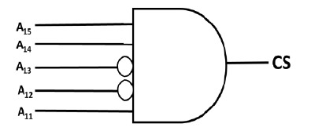

# 2019 CS2 Q12: Address range enabled by a chip-select gate

## Question

The chip select logic for a certain DRAM chip in a memory system design is shown below. Assume that the memory system has 16 address lines denoted by $A_{15}$ to $A_0$. What is the range of addresses (in hexadecimal) of the memory system that can get enabled by the chip select (CS) signal?

- (A) C800 to CFFF
- (B) CA00 to CAFF
- (C) C800 to C8FF
- (D) DA00 to DFFF

Answer

**A**

Solution

The gate is an AND, so CS = 1 only when every input is 1. The bubbles on $A_{13}$ and $A_{12}$ invert those inputs, so they must be **0**.

| $A_{15}$ | $A_{14}$ | $A_{13}$ | $A_{12}$ | $A_{11}$ |
|---|---|---|---|---|
| 1 | 1 | 0 | 0 | 1 |

The lowest 11 lines $A_{10}$ to $A_0$ do not reach the gate, so they can be anything.

- Lowest address: $1100\;1000\;0000\;0000 = $ **C800**
- Highest address: $1100\;1111\;1111\;1111 = $ **CFFF**

That is $2^{11} = 2048$ addresses (2 kB), all enabled.

**Why the others fail:**

- (B) and (C) are sub-ranges. CS is also 1 for the rest of C800 to CFFF.
- (D) DA00 starts with $1101$, so $A_{12} = 1$. The inverted input then gives 0.

**Key idea:** the pattern on the gate inputs fixes the top bits. The free low bits give one contiguous block.

