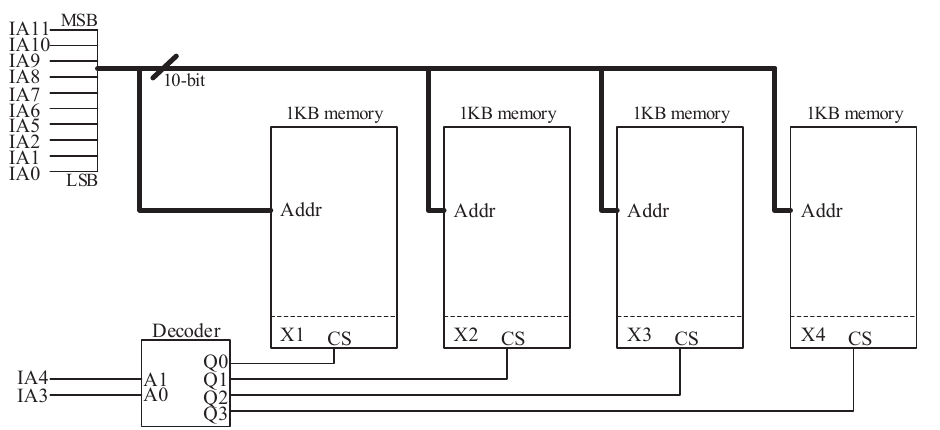

# 2023 CS Q42: Starting addresses of four memory blocks

## Question

A 4 kilobyte (KB) byte-addressable memory is realized using four 1 KB memory blocks. Two input address lines (IA4 and IA3) are connected to the chip select (CS) port of these memory blocks through a decoder as shown in the figure. The remaining ten input address lines from IA11 to IA0 are connected to the address port of these blocks. The chip select (CS) is active high.

The input memory addresses (IA11 to IA0), in decimal, for the starting locations (Addr = 0) of each block (indicated as X1, X2, X3, X4 in the figure) are among the options given below. Which one of the following options is CORRECT?

- (A) (0, 1, 2, 3)
- (B) (0, 1024, 2048, 3072)
- (C) (0, 8, 16, 24)
- (D) (0, 0, 0, 0)

Answer

**C ((0, 8, 16, 24))**

Solution

**Which lines select the block.** The decoder uses IA4 and IA3. The other ten lines (IA11 to IA5 and IA2 to IA0) are the in-block address. A block starts at in-block address 0, so those ten lines are 0.

**Block start = value of the IA4 IA3 bits** (IA3 has weight $2^3 = 8$, IA4 has weight $2^4 = 16$):

| Block | Decoder output | IA4 IA3 | Address |
|---|---|---|---|
| X1 | Q0 | 00 | 0 |
| X2 | Q1 | 01 | 8 |
| X3 | Q2 | 10 | 16 |
| X4 | Q3 | 11 | 24 |

**Why the others fail:** A would need the select bits at weight 1. B would need them to be IA11 and IA10 (the top bits). D would mean all four blocks respond to the same address.

**Key idea:** the *position* of the chip-select bits in the address decides the start addresses. Here the blocks are interleaved in small chunks of 8 bytes.

