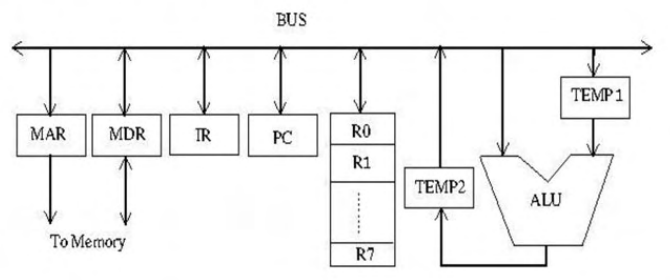

# 2020 CS Q14: Order of micro-steps for R0 = R1 + R2 on a single-bus data path

## Question

Consider the following data path diagram.

Consider an instruction: R0 ← R1 + R2. The following steps are used to execute it over the given data path. Assume that PC is incremented appropriately. The subscripts r and w indicate read and write operations, respectively.

1. R2r, TEMP1r, ALUadd, TEMP2w
2. R1r, TEMP1w
3. PCr, MARw, MEMr
4. TEMP2r, R0w
5. MDRr, IRw

Which one of the following is the correct order of execution of the above steps?

- (A) 2, 1, 4, 5, 3
- (B) 1, 2, 4, 3, 5
- (C) 3, 5, 2, 1, 4
- (D) 3, 5, 1, 2, 4

Answer

**C**

Solution

**Phase 1: fetch the instruction.**

- Step 3: the PC goes onto the bus into MAR, and memory is read.
- Step 5: the word arrives in MDR and is moved into IR.

The instruction must be in IR before it can be executed, so 3 then 5 come first.

**Phase 2: execute.** There is only one bus, so only one register can be read per step.

- Step 2: R1 goes onto the bus and is saved in TEMP1.
- Step 1: R2 goes onto the bus as one ALU input, TEMP1 (holding R1) is the other, and the ALU adds. The sum is written to TEMP2.
- Step 4: TEMP2 goes onto the bus and is written to R0.

Order: **3, 5, 2, 1, 4**.

**Why the others fail:**

- **(A) and (B)** start executing before the instruction is fetched.
- **(D)** fetches correctly, but runs step 1 before step 2. TEMP1 would not yet hold R1, so the ALU would add R2 to a stale value.

**Key idea:** fetch first (PC to MAR, memory, MDR to IR). Then, on a single bus, stage the first operand in a temporary register before the ALU step.

