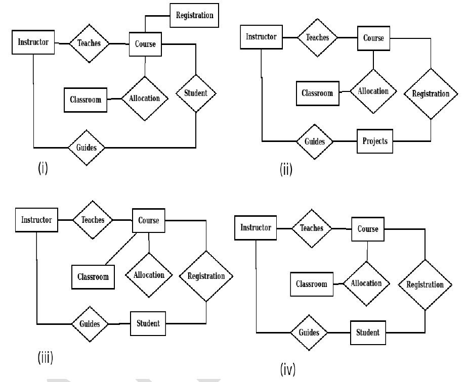

# 2024 CS1 Q20: Choosing the correct ER diagram for a specification

## Question

Let S be the specification: "Instructors teach courses. Students register for courses. Courses are allocated classrooms. Instructors guide students." Which one of the following ER diagrams CORRECTLY represents S?

- (A) (i)
- (B) (ii)
- (C) (iii)
- (D) (iv)

Answer

**D (iv)**

Solution

**The specification needs four relationships**, each between two entities:

| Sentence | Relationship | Entities |
|---|---|---|
| Instructors teach courses | Teaches | Instructor – Course |
| Students register for courses | Registration | Student – Course |
| Courses are allocated classrooms | Allocation | Course – Classroom |
| Instructors guide students | Guides | Instructor – Student |

**Check each diagram:**

- **(i)** "Registration" is drawn as an entity box, not a relationship diamond, so Student and Course are not linked by a relationship.
- **(ii)** Guides links Instructor to an entity called "Projects", which the specification never mentions. Student is missing.
- **(iii)** Classroom is joined directly to Course by a plain line and not through the Allocation diamond, so Allocation is left dangling.
- **(iv)** All four diamonds join the right pairs: Instructor–Teaches–Course, Course–Allocation–Classroom, Course–Registration–Student, Instructor–Guides–Student. ✓

**Key idea:** verbs in the specification become relationship diamonds, and nouns become entity boxes. Every diamond must connect two entities.

