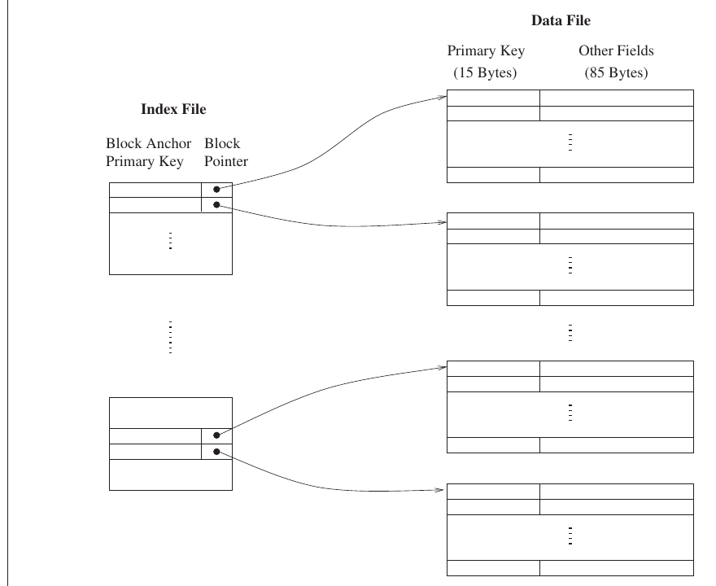

# 2023 CS Q62: Block accesses to search a primary index

## Question

Consider a database of fixed-length records, stored as an ordered file. The database has 25,000 records, with each record being 100 bytes, of which the primary key occupies 15 bytes. The data file is block-aligned in that each data record is fully contained within a block. The database is indexed by a primary index file, which is also stored as a block-aligned ordered file. The figure below depicts this indexing scheme.

Suppose the block size of the file system is 1024 bytes, and a pointer to a block occupies 5 bytes. The system uses binary search on the index file to search for a record with a given key. You may assume that a binary search on an index file of $b$ blocks takes $\lceil \log_2 b \rceil$ block accesses in the worst case.

Given a key, the number of block accesses required to identify the block in the data file that may contain a record with the key, in the worst case, is ______.

Answer

**6**

Solution

**Data file.**
- Records per block: $\lfloor 1024 / 100 \rfloor = 10$ (a record cannot straddle blocks).
- Data blocks: $25000 / 10 = 2500$.

**Index file (primary index: one entry per data block).**
- Entry size: $15 + 5 = 20$ bytes.
- Entries per block: $\lfloor 1024 / 20 \rfloor = 51$.
- Entries needed: 2500.
- Index blocks: $\lceil 2500 / 51 \rceil = 50$.

**Binary search on the index.**

$$\lceil \log_2 50 \rceil = 6$$

**Key idea:** a primary index has one entry per *data block*, not per record.

