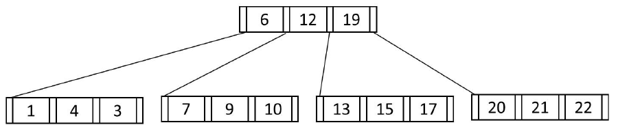
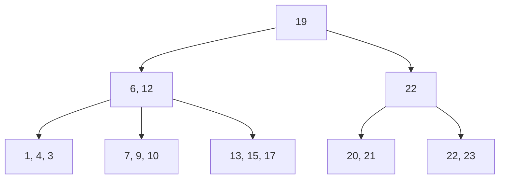

# 2025 CS1 Q21: Inserting 23 into a B+ tree

## Question

Consider the following $B^+$ tree with 5 nodes, in which a node can store at most 3 key values. The value 23 is now inserted in the $B^+$ tree. Which of the following options(s) is/are CORRECT?

- (A) None of the nodes will split.
- (B) At least one node will split and redistribute.
- (C) The total number of nodes will remain same.
- (D) The height of the tree will increase.

Answer

**B and D**

Solution

(In the figure, the first leaf is printed as "1, 4, 3", which is out of order. This is probably a printing slip and does not affect the answer, since 23 goes to the last leaf.)

**Step 1: find the leaf.** $23 \ge 19$, so it goes to the last leaf $[20, 21, 22]$. That leaf is **full** (3 keys), so adding 23 gives 4 keys: it **splits** into $[20, 21]$ and $[22, 23]$, and the key $22$ (smallest in the new leaf) is copied up to the parent.

**Step 2: the parent overflows.** The root $[6, 12, 19]$ is also full. Adding 22 gives $[6, 12, 19, 22]$, 4 keys, so the root **splits** too. The middle key $19$ moves up, giving a left node $[6, 12]$ and a right node $[22]$ under a **new root** $[19]$.

*The tree after inserting 23.*

| Option | Verdict | Reason |
|---|---|---|
| A: no node splits | False | The leaf and the root both split |
| **B: some node splits and redistributes** | True | |
| C: node count stays the same | False | It grows from 5 to 8 (new leaf, new internal node, new root) |
| **D: height increases** | True | A new root was created, so the tree is one level taller |

**Key idea:** a split that overflows a full parent propagates upward, and if it reaches a full root the tree grows by one level.

