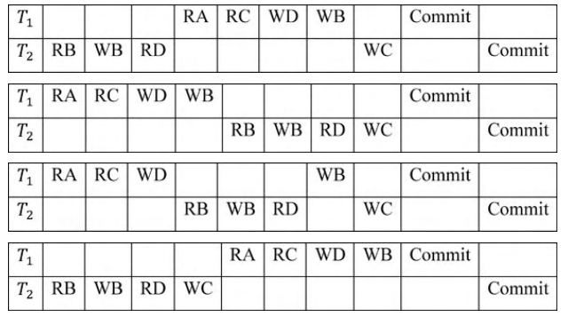

# 2020 CS Q47: Conflict-equivalent schedule of two transactions

## Question

Consider a schedule of transactions $T_1$ and $T_2$:

Here, RX stands for "Read(X)" and WX stands for "Write(X)". Which one of the following schedules is conflict equivalent to the above schedule?

Transcribed in time order (the figure is the authority). A subscript shows the transaction, and C1, C2 are the commits, which come last in every schedule:

- (A) R2(B), W2(B), R2(D), R1(A), R1(C), W1(D), W1(B), W2(C), C1, C2
- (B) R1(A), R1(C), W1(D), W1(B), R2(B), W2(B), R2(D), W2(C), C1, C2
- (C) R1(A), R1(C), W1(D), R2(B), W2(B), R2(D), W1(B), W2(C), C1, C2
- (D) R2(B), W2(B), R2(D), W2(C), R1(A), R1(C), W1(D), W1(B), C1, C2

Answer

**A**

Solution

**Conflict equivalence.** Two schedules are conflict equivalent if they have the same operations and every **conflicting pair** (different transactions, same item, at least one write) occurs in the same order in both.

**Original schedule** in time order: R1(A), R2(B), W2(B), R1(C), R2(D), W1(D), W2(C), W1(B).

| Item | Conflicting pairs, in original order | Direction |
|---|---|---|
| A | only $T_1$ touches it | none |
| B | R2(B) and W2(B) come before W1(B) | $T_2 \to T_1$ |
| C | R1(C) comes before W2(C) | $T_1 \to T_2$ |
| D | R2(D) comes before W1(D) | $T_2 \to T_1$ |

Any equivalent schedule must keep: **both $T_2$ operations on B before W1(B)**, **R1(C) before W2(C)**, and **R2(D) before W1(D)**. (The precedence graph has edges both ways, so the original is not serializable, which is why the answer is another interleaving, not a serial order.)

**Check the options:**

| Option | B: T2's R, W before W1(B)? | C: R1(C) before W2(C)? | D: R2(D) before W1(D)? | Result |
|---|---|---|---|---|
| (A) | yes | yes | yes | **equivalent** |
| (B) | **no** (W1(B) comes first) | yes | **no** | not equivalent |
| (C) | yes | yes | **no** (W1(D) before R2(D)) | not equivalent |
| (D) | yes | **no** (W2(C) before R1(C)) | yes | not equivalent |

Only **(A)** preserves all three orders. I also compared the sets of conflicting pairs of each option with the original in code, with the same result.

**Key idea:** list the conflicting pairs of the original schedule and keep each pair's order. Any option that flips even one pair is not conflict equivalent.

