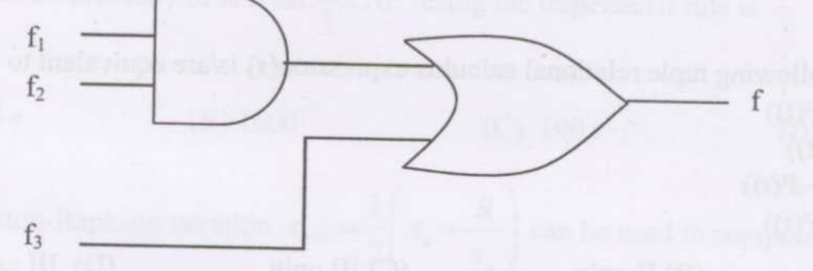

# 2008 CS Q8: Finding f2 from f1, f3 and the output f

## Question

Given $f_1$, $f_3$ and $f$ in canonical sum of products form (in decimal) for the circuit

$$f_1 = \Sigma\, m(4,5,6,7,8), \quad f_3 = \Sigma\, m(1,6,15), \quad f = \Sigma\, m(1,6,8,15)$$

then $f_2$ is

- (A) $\Sigma\, m(4,6)$
- (B) $\Sigma\, m(4,8)$
- (C) $\Sigma\, m(6,8)$
- (D) $\Sigma\, m(4,6,8)$

Answer

**C**

Solution

The circuit computes $f = f_1 \cdot f_2 + f_3$. Test each option, with $f_1 \cdot f_2$ being the minterms common to both:

| $f_2$ | $f_1 \cdot f_2$ | $f_1 f_2 + f_3$ | Equals $\lbrace 1,6,8,15 \rbrace$? |
|---|---|---|---|
| (A) $\lbrace 4,6 \rbrace$ | $\lbrace 4,6 \rbrace$ | $\lbrace 1,4,6,15 \rbrace$ | no |
| (B) $\lbrace 4,8 \rbrace$ | $\lbrace 4,8 \rbrace$ | $\lbrace 1,4,6,8,15 \rbrace$ | no |
| (C) $\lbrace 6,8 \rbrace$ | $\lbrace 6,8 \rbrace$ | $\lbrace 1,6,8,15 \rbrace$ | **yes** |
| (D) $\lbrace 4,6,8 \rbrace$ | $\lbrace 4,6,8 \rbrace$ | $\lbrace 1,4,6,8,15 \rbrace$ | no |

Minterm $8$ must come from $f_1 f_2$ (it is not in $f_3$), so $8 \in f_2$. Minterms $4, 5, 7$ must **not** be in $f_1 f_2$, so they are not in $f_2$. Only option (C) fits.

**Code check:** a short script evaluated $f_1 f_2 + f_3$ for each option and matched $f$ only for (C).

**Key idea:** the output is $f_1 f_2 + f_3$, so every minterm of $f$ outside $f_3$ must be in both $f_1$ and $f_2$, and no extra minterm of $f_1$ may be in $f_2$.

