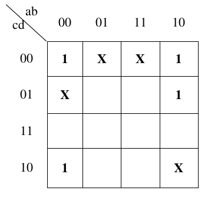

# 2012 CS Q30: Minimal form of a Karnaugh map with don't cares

## Question

What is the minimal form of the Karnaugh map shown below? Assume that X denotes a don't care term.

- (A) $\bar{b}\bar{d}$
- (B) $\bar{b}\bar{d} + \bar{b}\bar{c}$
- (C) $\bar{b}\bar{d} + a\bar{b}\bar{c}d$
- (D) $\bar{b}\bar{d} + \bar{b}\bar{c} + \bar{c}\bar{d}$

Answer

**B**

Solution

**The 1s** (as $abcd$): $0000$, $1000$, $1001$, $0010$.

**Group 1: $\bar{b}\bar{d}$.** The four cells with $b = 0, d = 0$ are $0000, 1000, 0010, 1010$. The last is a don't care, so this quad covers three 1s.

**Group 2: $\bar{b}\bar{c}$.** The four cells with $b = 0, c = 0$ are $0000, 1000, 0001, 1001$. The cell $0001$ is a don't care, so this quad covers the remaining 1 at $1001$.

$$f = \bar{b}\bar{d} + \bar{b}\bar{c}.$$

**Why the others fail:**

- (A) leaves the 1 at $1001$ uncovered.
- (C) is a valid cover but not minimal: the 4-literal term $a\bar{b}\bar{c}d$ is a single cell, where $\bar{b}\bar{c}$ is a 2-literal quad.
- (D) is also a valid cover, but $\bar{c}\bar{d}$ is redundant.

**Code check:** over all 16 inputs, (B), (C) and (D) cover every 1 and no 0; (A) misses a 1. (B) has the fewest terms and literals (2 terms, 4 literals, against 2 terms and 7 literals for (C), and 3 terms and 6 literals for (D)).

**Key idea:** use don't cares to enlarge groups; fewer, larger groups give the minimal sum of products.

