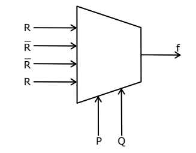

# 2010 CS Q9: Output of a 4-to-1 multiplexer with R and R' data inputs

## Question

The Boolean expression for the output $f$ of the multiplexer shown below is

- (A) $\overline{P \oplus Q \oplus R}$
- (B) $P \oplus Q \oplus R$
- (C) $P + Q + R$
- (D) $\overline{P + Q + R}$

Answer

**B**

Solution

Read the data inputs top to bottom as $I_0 = R$, $I_1 = \overline{R}$, $I_2 = \overline{R}$, $I_3 = R$, with selects $P, Q$.

| $PQ$ | selected input | $f$ |
|---|---|---|
| 00 | $I_0$ | $R$ |
| 01 | $I_1$ | $\overline{R}$ |
| 10 | $I_2$ | $\overline{R}$ |
| 11 | $I_3$ | $R$ |

So $f = R$ when $P = Q$ and $f = \overline{R}$ when $P \ne Q$:

$$f = (P \oplus Q)\,\overline{R} + \overline{(P \oplus Q)}\,R = P \oplus Q \oplus R$$

(B). Since $I_1 = I_2$, it makes no difference which select is the most significant bit.

- (A) is the complement of (B).
- (C) fails at $PQR = 110$: the mux gives $I_3 = R = 0$ but $P + Q + R = 1$.
- (D) fails at $PQR = 000$: the mux gives $0$ but $\overline{P + Q + R} = 1$.

**Code check:** all 8 inputs, with both select orders, matched only option (B).

**Key idea:** a mux whose data inputs alternate $R, \overline{R}, \overline{R}, R$ computes a 3-input XOR.

