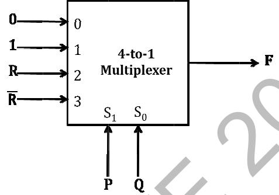

# 2014 CS1 Q45: Minimal SOP of the output of a 4-to-1 multiplexer

## Question

Consider the 4-to-1 multiplexer with two select lines $S_1$ and $S_0$ given below.

The minimal sum-of-products form of the Boolean expression for the output $F$ of the multiplexer is

- (A) $\bar{P}Q + Q\bar{R} + P\bar{Q}R$
- (B) $\bar{P}Q + \bar{P}Q\bar{R} + PQ\bar{R} + P\bar{Q}R$
- (C) $\bar{P}QR + \bar{P}Q\bar{R} + Q\bar{R} + P\bar{Q}R$
- (D) $PQ\bar{R}$

Answer

**A**

Solution

With $S_1 = P$ and $S_0 = Q$, input $i$ is selected when $PQ$ equals the binary number $i$:

| $P\,Q$ | Input | Value |
|---|---|---|
| 00 | I0 | 0 |
| 01 | I1 | 1 |
| 10 | I2 | $R$ |
| 11 | I3 | $\bar{R}$ |

$$F = \bar{P}Q + P\bar{Q}R + PQ\bar{R}$$

Combine the first and third terms: $\bar{P}Q + PQ\bar{R} = Q(\bar{P} + P\bar{R}) = Q(\bar{P} + \bar{R}) = \bar{P}Q + Q\bar{R}$. So

$$F = \bar{P}Q + Q\bar{R} + P\bar{Q}R$$

**Code check:** `sympy.simplify_logic` gives `(Q & ~P) | (Q & ~R) | (P & R & ~Q)`.

- (B) and (C) are the same function but not minimal; they carry redundant terms (for example $\bar{P}Q + \bar{P}Q\bar{R}$ reduces to $\bar{P}Q$).
- (D) is only the $PQ\bar{R}$ term, missing the others.

**Key idea:** a 4-to-1 mux gives $F = \sum (\text{select minterm}) \cdot (\text{input})$; then minimise.

