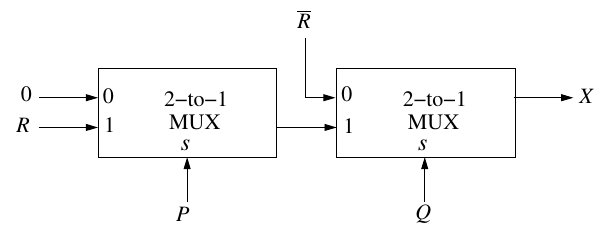

# 2016 CS1 Q30: Minimal sum of products of two cascaded 2-to-1 multiplexers

## Question

Consider the two cascaded 2-to-1 multiplexers as shown in the figure.

- (A) $\bar{P}\bar{Q} + PQR$
- (B) $\bar{P}Q + QR$
- (C) $PQ + \bar{P}\bar{Q}R$
- (D) $\bar{Q}\bar{R} + PQR$

Answer

**D**

Solution

A 2-to-1 MUX with select $s$ outputs $\bar{s}\,I_0 + s\,I_1$.

**First MUX** (select $P$, inputs $I_0 = 0$, $I_1 = R$):

$$Y = \bar{P}\cdot 0 + P\,R = PR$$

**Second MUX** (select $Q$, inputs $I_0 = \bar{R}$, $I_1 = Y$):

$$X = \bar{Q}\,\bar{R} + Q\,(PR) = \bar{Q}\bar{R} + PQR$$

**Is it minimal?** $X = 1$ for minterms $000$ and $100$ (covered by $\bar{Q}\bar{R}$) and for $111$. The minterm $111$ has no adjacent $1$ cell (its neighbours $011$, $101$, $110$ give $X = 0$), so $PQR$ cannot be shortened. The form is minimal, which is **(D)**.

**Why the others fail.** (A), (B) and (C) disagree with $X$ on some input, for example at $PQR = 100$: $X = \bar{Q}\bar{R} = 1$, but (A) gives $0$, (B) gives $0$ and (C) gives $0$.

**Code check:** evaluating the MUX network on all $8$ input combinations matched $\bar{Q}\bar{R} + PQR$ in every case.

**Key idea:** write each MUX as $\bar{s}I_0 + sI_1$ and substitute the first output into the second.

