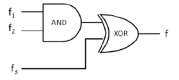

# 2019 CS2 Q40: Output of an AND-XOR circuit from minterm lists

## Question

Consider three 4-variable functions $f_1$, $f_2$, and $f_3$, which are expressed in sum-of-minterms as

$f_1 = \Sigma(0, 2, 5, 8, 14)$, $\quad f_2 = \Sigma(2, 3, 6, 8, 14, 15)$, $\quad f_3 = \Sigma(2, 7, 11, 14)$

For the following circuit with one AND gate and one XOR gate, the output function $f$ can be expressed as:

- (A) $\Sigma(7, 8, 11)$
- (B) $\Sigma(2, 7, 8, 11, 14)$
- (C) $\Sigma(2, 14)$
- (D) $\Sigma(0, 2, 3, 5, 6, 7, 8, 11, 14, 15)$

Answer

**A**

Solution

The circuit computes $f = (f_1 \cdot f_2) \oplus f_3$. Work on minterm sets.

| Step | Minterms |
|---|---|
| $f_1$ | 0, 2, 5, 8, 14 |
| $f_2$ | 2, 3, 6, 8, 14, 15 |
| $f_1 \cdot f_2$ (common to both) | 2, 8, 14 |
| $f_3$ | 2, 7, 11, 14 |
| $(f_1 f_2) \oplus f_3$ (in exactly one) | **7, 8, 11** |

Minterms 2 and 14 are in both sets, so XOR cancels them. Minterm 8 is only in the AND. Minterms 7 and 11 are only in $f_3$.

**Why the others fail:**

- (B) is $f_1 f_2 + f_3$ (OR instead of XOR).
- (C) is the intersection $f_1 f_2 f_3$.
- (D) is $f_1 + f_2 + f_3$, the OR of all three.

**Code check:** set operations on the minterm lists give $\lbrace 7, 8, 11\rbrace$.

**Key idea:** AND on minterm sets is intersection. XOR is symmetric difference.

