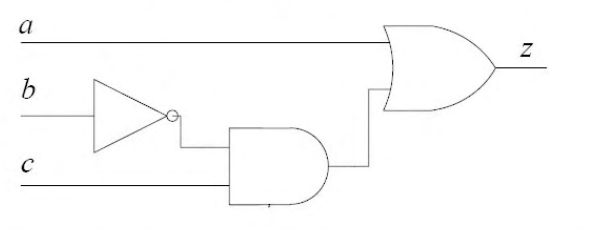

# 2020 CS Q38: Minterm list of a three-gate circuit

## Question

Consider the Boolean function $z(a, b, c)$.

Which one of the following minterm lists represents the circuit given above?

- (A) $z = \sum (0, 1, 3, 7)$
- (B) $z = \sum (1, 4, 5, 6, 7)$
- (C) $z = \sum (2, 4, 5, 6, 7)$
- (D) $z = \sum (2, 3, 5)$

Answer

**B**

Solution

**Write the function.** The NOT gate gives $\overline{b}$, the AND gate gives $\overline{b}\,c$, and the OR gate combines it with $a$:

$$z = a + \overline{b}\,c.$$

**List the minterms**, numbering $abc$ as a 3-bit number with $a$ as the most significant bit:

- $a = 1$ makes $z = 1$ for all four inputs $100, 101, 110, 111$, which are minterms **4, 5, 6, 7**.
- $a = 0$: $z = \overline{b}\,c$, which is 1 only for $b = 0, c = 1$, that is $001$, minterm **1**.

So $z = \sum (1, 4, 5, 6, 7)$. I confirmed this by evaluating the circuit on all 8 inputs in code.

**Why the others fail:**

- **(A)** includes 0 ($abc = 000$): there $a = 0$ and $\overline{b}c = 0$, so $z = 0$. It also misses 4, 5, 6.
- **(C)** includes 2 ($010$): there $a = 0$ and $\overline{b} = 0$, so $z = 0$. It also misses 1.
- **(D)** includes 2 and 3, which have $b = 1$, so $\overline{b}\,c = 0$ and $z = 0$. It misses all the $a = 1$ cases.

**Key idea:** read the circuit as an expression ($a + \overline{b}c$), then expand it over all input combinations.

