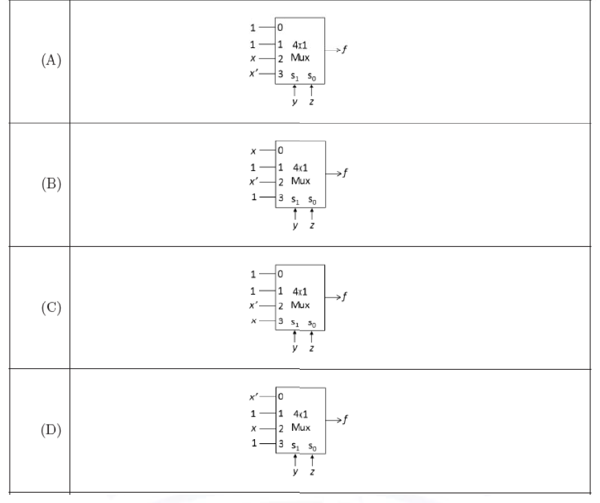

# 2021 CS2 Q15: 4x1 multiplexer implementation of a Boolean function

## Question

Which one of the following circuits implements the Boolean function given below?

$f(x,y,z)=m_0+m_1+m_3+m_4+m_5+m_6$, where $m_i$ is the $i^{th}$ minterm.

Answer

**A**

Solution

With select lines $S_1=y$ and $S_0=z$, data input $I_{yz}$ must equal $f(x,y,z)$ as a function of $x$. The minterms present are 0, 1, 3, 4, 5, 6 (missing 2 and 7).

| $yz$ | $x=0$ (minterm) | $x=1$ (minterm) | Required $I$ |
|---|---|---|---|
| 00 | $m_0$: present | $m_4$: present | 1 |
| 01 | $m_1$: present | $m_5$: present | 1 |
| 10 | $m_2$: absent | $m_6$: present | $x$ |
| 11 | $m_3$: present | $m_7$: absent | $x'$ |

So $I_0=1,\ I_1=1,\ I_2=x,\ I_3=x'$. That is (A).

(B), (C) and (D) were each checked against the truth table: they give wrong values, for example at $x=0,y=1,z=0$.

**Key idea:** to implement $f(x,y,z)$ with a 4-to-1 mux, use $y,z$ as selects and feed each data input the cofactor of $f$ with respect to $x$.

